# 折本・二色刷り・汀線・標示盤を3画面で見比べる

| 案 | 申請一覧 | 新規申請フォーム | ダッシュボード |
| --- | --- | --- | --- |
| **H′ 折本** | [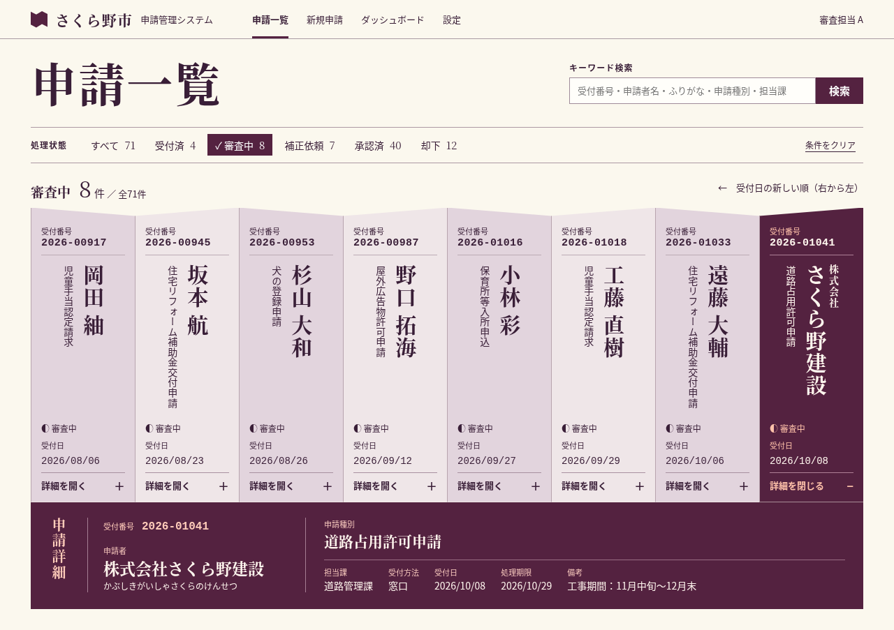](../h-prime/images/h-prime-list-1280.png) | [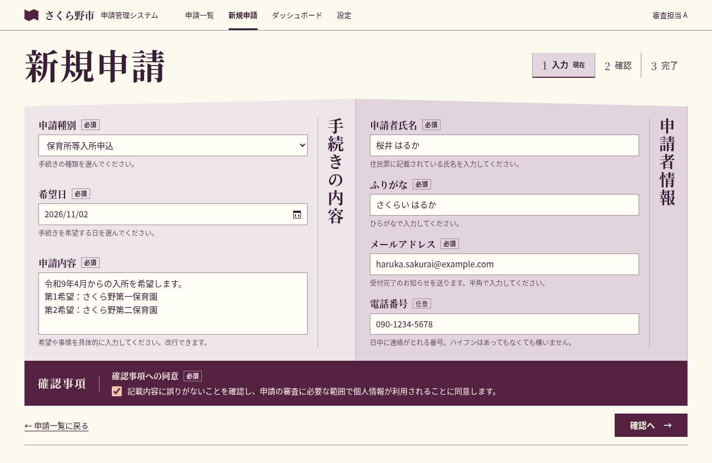](../form-comparison/images/h-prime-form-1280.png) | [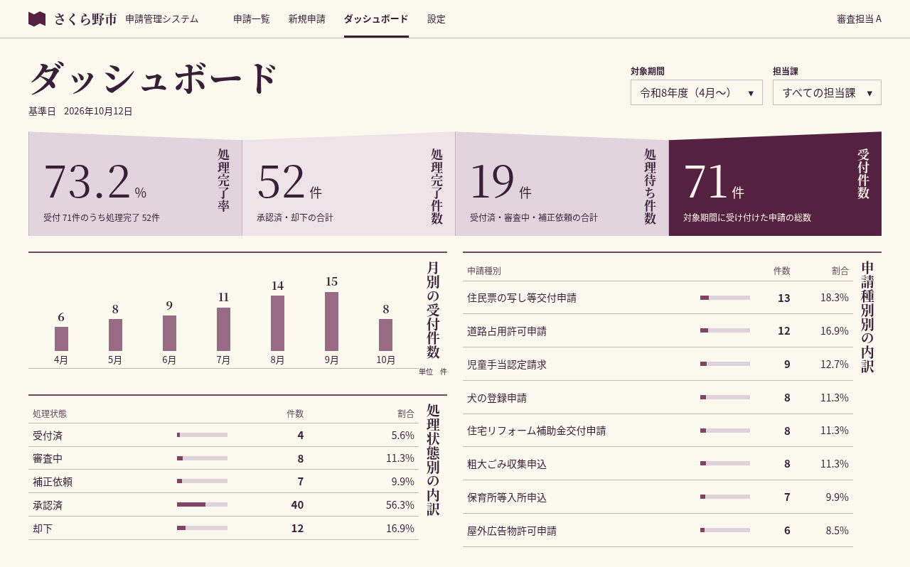](../dashboard-comparison/images/h-prime-dashboard-1280.png) |
| **J 二色刷り** | [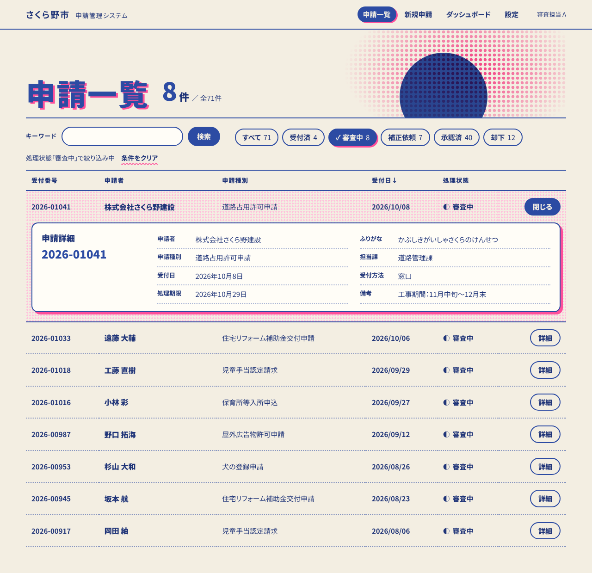](../design-exploration-3/images/j-list-1280.png) | [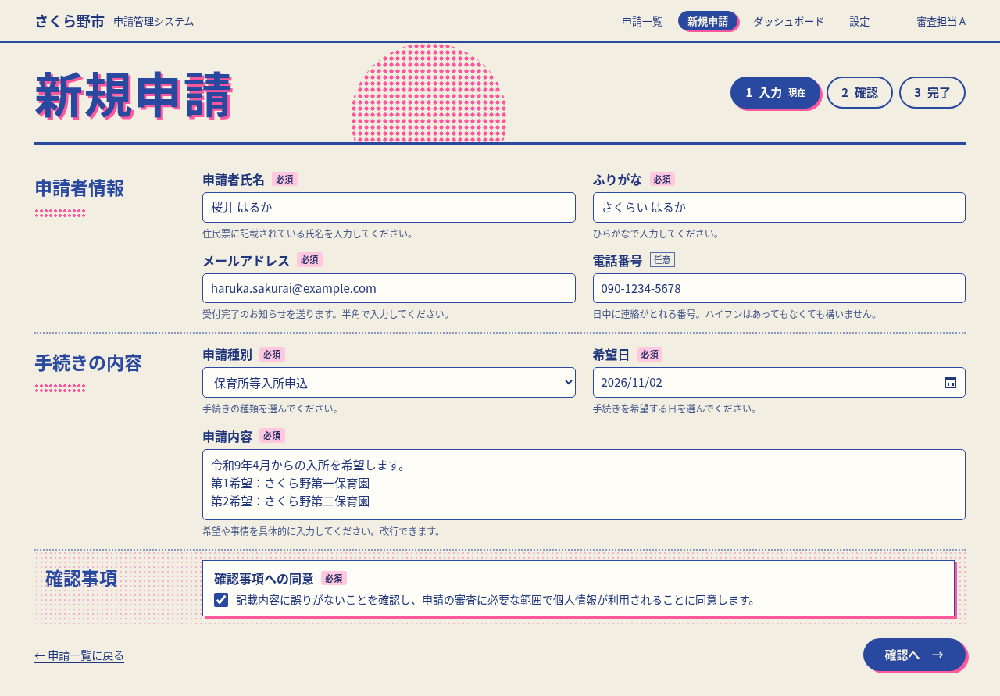](../form-comparison/images/j-form-1280.png) | [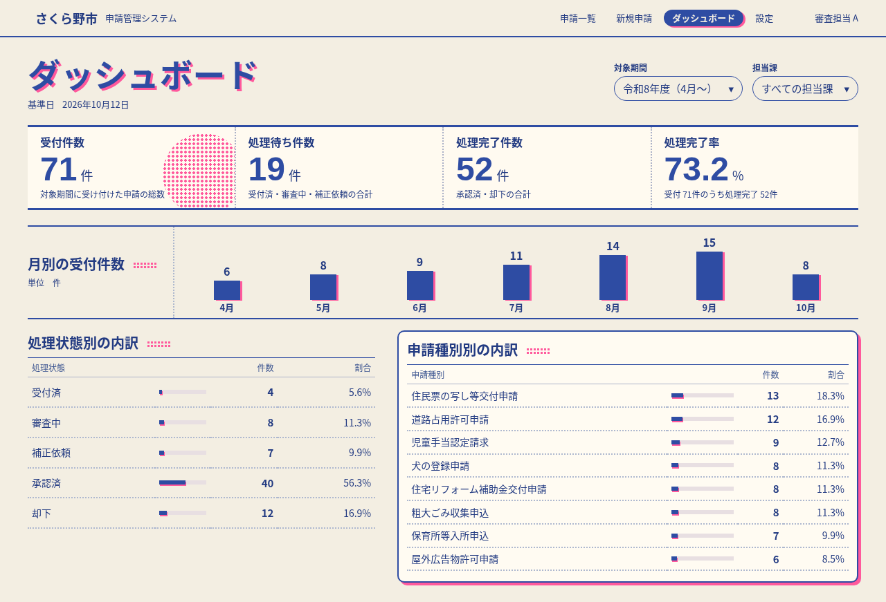](../dashboard-comparison/images/j-dashboard-1280.png) |
| **K 汀線** | [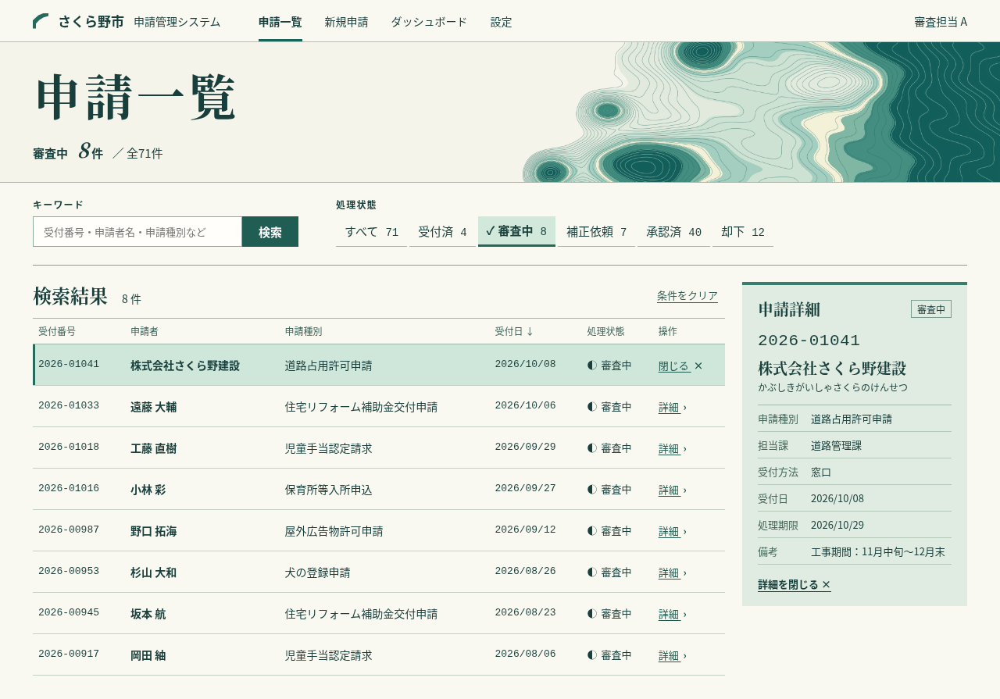](../design-exploration-4/images/k-list-1280.png) | [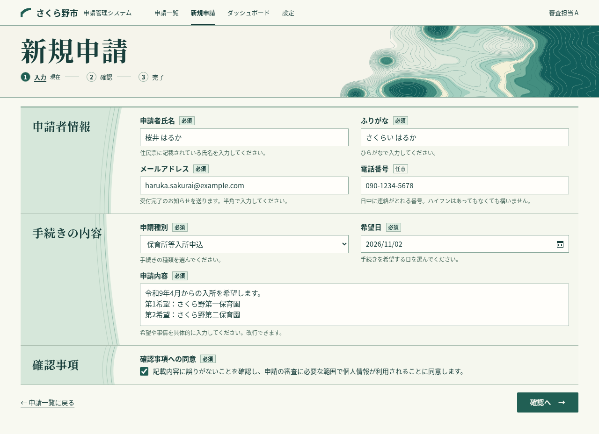](../form-comparison/images/k-form-1280.png) | [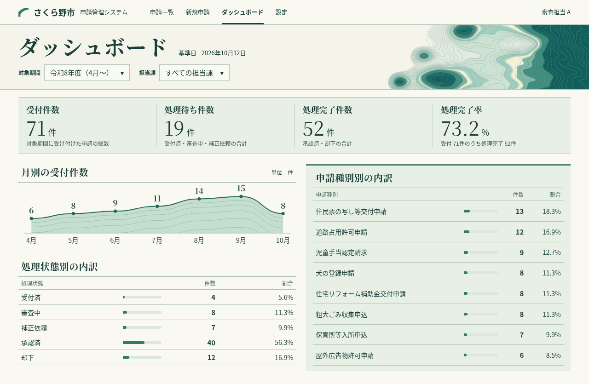](../dashboard-comparison/images/k-dashboard-1280.png) |
| **L 標示盤** | [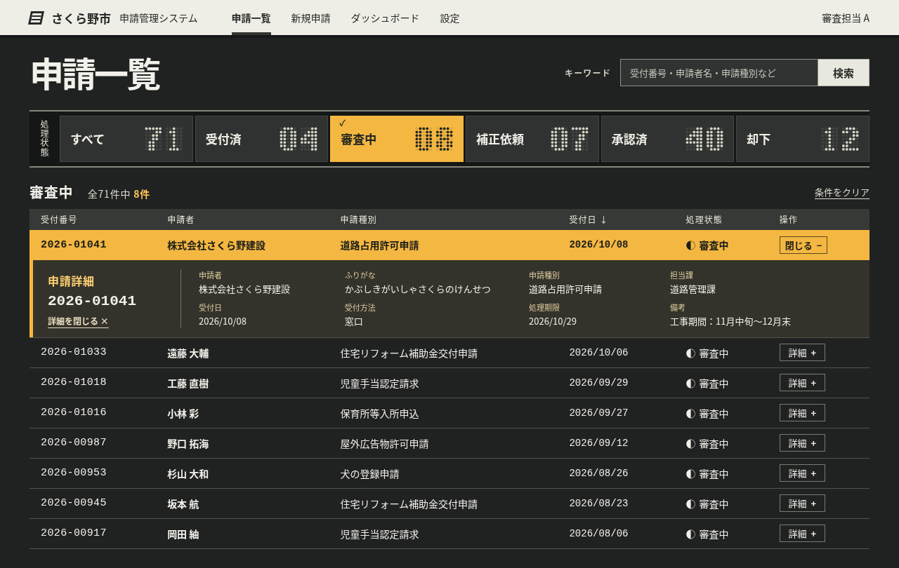](../design-exploration-4/images/l-list-1280.png) | [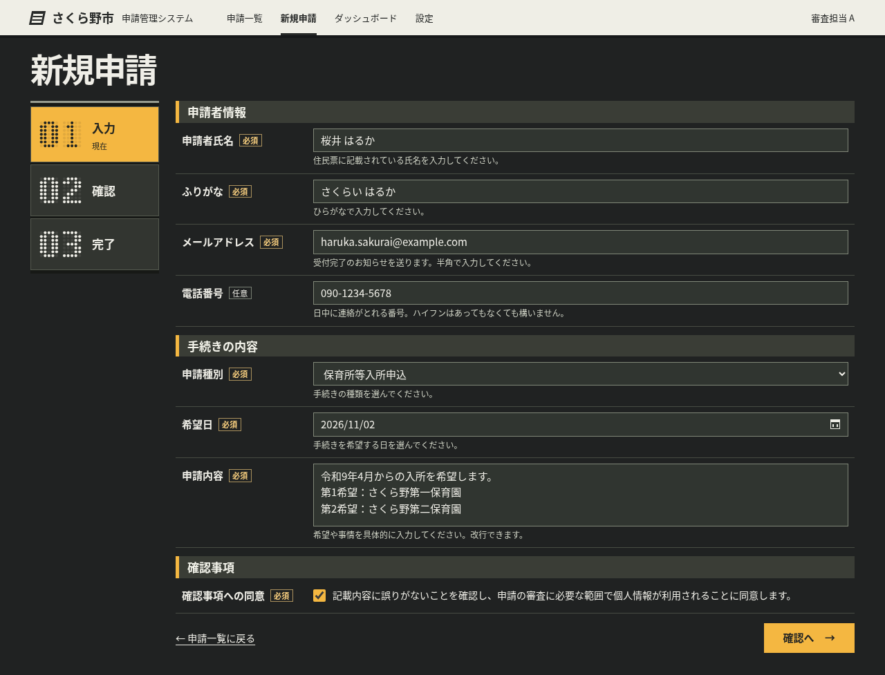](../form-comparison/images/l-form-1280.png) | [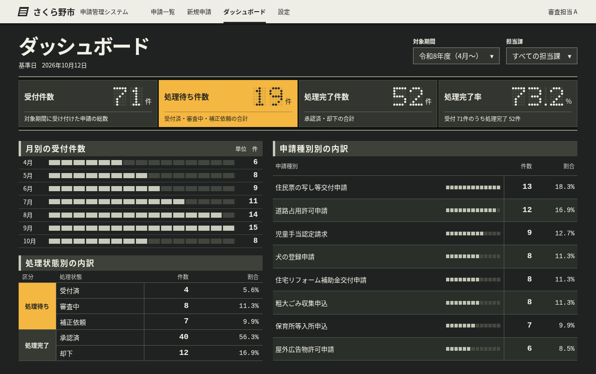](../dashboard-comparison/images/l-dashboard-1280.png) |

各画像を選ぶと原寸（幅1280px）で開く。4案とも継続検討中。以下は静止画に基づく所感で、操作時の読み順や照合速度は未検証。[基準デザイン「糸の交点」](../okinawa-ui-study/README.md)

**ユーザー評価**　フォームではH′単体に以前からの改善が見られ、J・Kの評価は従前のまま。Lはドット表現が手順部分に集中し、画面全体での印象が弱まった。ダッシュボードではH′・J・Lが強調箇所に記号的なアクセントを置ける点と、Lで画面全体が調和しやすくなった点が評価された。[Issue #56](https://github.com/YanTKYS/design-lab/issues/56)

### H′「折本」

**画面で見えること**　折り目の一面が、一覧では一件の申請、フォームでは入力項目の一章、ダッシュボードでは一つの指標に対応する。右端の「受付件数 71件」は一面を葡萄色で満たし、縦の項目名に横の数字を添えている。

**所感**　上辺の折れと縦見出しが、情報のまとまりを示す目印として3画面に通っている。確認したいのは集計の読み順。右端の受付件数から左へ指標を追った後、すぐ下の月別グラフは左端の4月から読み始める。

### J「二色刷り」

**画面で見えること**　青い文字の脇にピンクがのぞく表題に加え、一覧では開いた行、フォームでは同意欄、集計では受付71件の横に網点が入る。月別の棒にもピンクの縁があり、件数は棒の上に青一色で載る。

**所感**　網点は囲み、縁取り、ひと塊の印へと大きさを変えられる。細かい文字を一色に保つので、表やグラフにも二色刷りの表情が残る。フォームでは同意欄の縁と直下の「確認へ」が同じピンクで強く見える。同意文を読む順序とボタンの目立ち方が釣り合うかを見たい。

### K「汀線」

**画面で見えること**　一覧は選択行と右の詳細欄を淡緑で結び、フォームは章見出しと白い入力面を曲線で仕切る。集計では月別の点の下に緑の面が広がり、9月の頂点に「15」とある。

**所感**　明るい余白の中で、面の広さと輪郭の変化が視線を導く。ヘッダーを離れても水際の印象が続き、グラフの山が自然なアクセントになる。滑らかな曲線が月の途中の観測値まで暗示して見える点は、月ごとの点と数字を先に拾えるかで確かめたい。

### L「標示盤」

**画面で見えること**　一覧では状態別の盤の「審査中 08」と選択行が琥珀色で対応する。フォームのドット数字は左の手順欄に集まり、右には横長の入力欄が続く。集計では上段の「処理待ち件数 19」と下段の「処理待ち」区分が同じ琥珀色で、その隣に受付済4件・審査中8件・補正依頼7件が並ぶ。月別・種別別の一目盛りはいずれも一件を表す。

**所感**　集計では区画名、数値の列、目盛りが連動し、大きく掲げた数字の根拠を下の明細でたどれる。これがフォームの手順欄だけでは得にくかった全体の調和につながる。フォームに残る検証点は、左の「01 入力」と右の入力本文との関係が、見出しや罫の配置からも伝わるかどうか。
