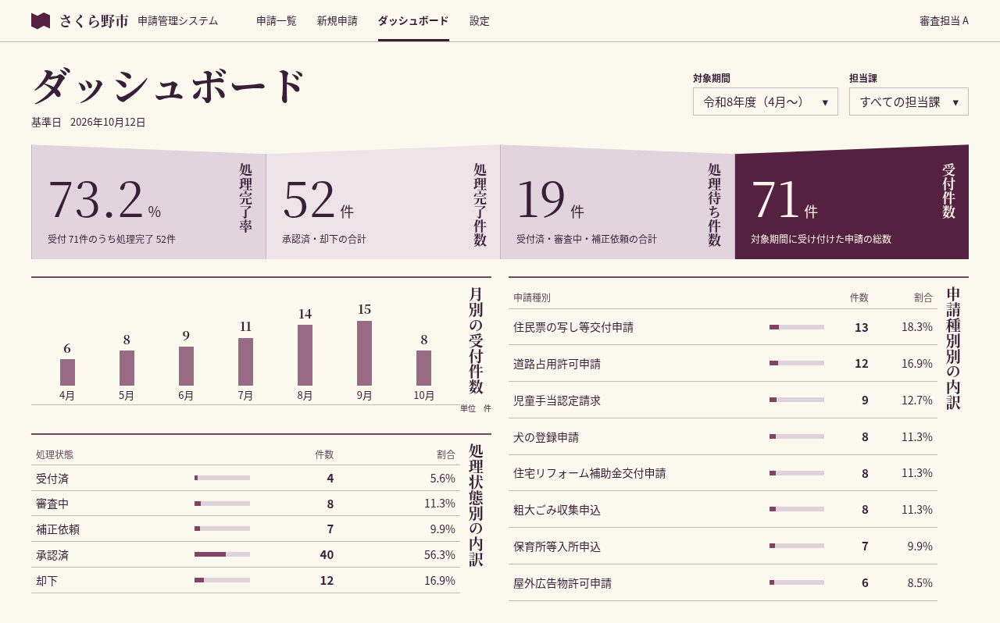
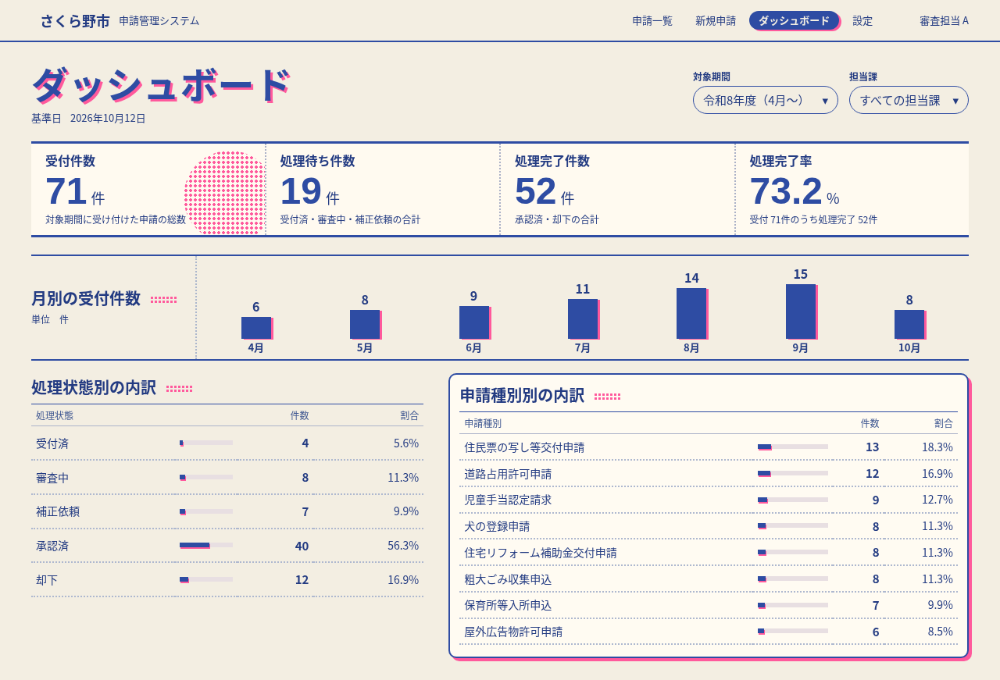
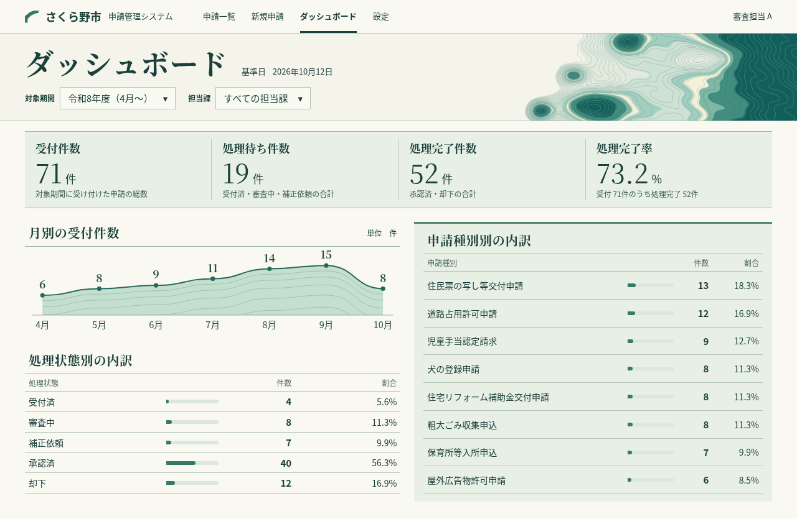
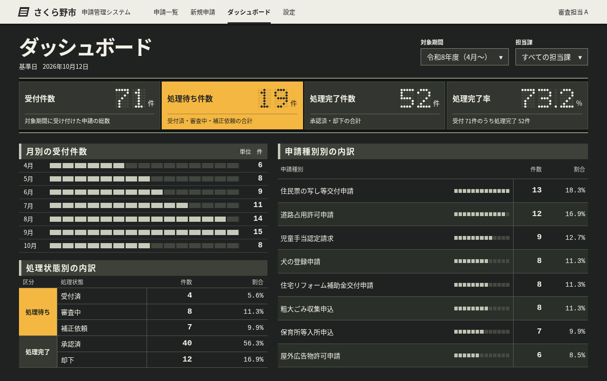

# 申請処理ダッシュボードの比較

| H′「折本」 | J「二色刷り」 |
| --- | --- |
|  |  |
| **K「汀線」** | **L「標示盤」** |
|  |  |

4枚とも幅1280px。共通モデルの既定条件（令和8年度・4月〜、すべての担当課、基準日2026年10月12日）で、受付71件、処理待ち19件、処理完了52件、処理完了率73.2%を表示した。画像を押すと原寸で比較できる。[「糸の交点」のダッシュボード](../okinawa-ui-study/site-thread-dashboard-1280.png)

## 一覧・フォームから何が引き継がれたか

- **H′「折本」**　一覧では一件、フォームでは一章だった紙面を、一指標ずつに割り当てた。右端の葡萄色の面で受付総数を押さえ、縦の見出しと横の数値を対にして読める。指標は右から左、月別のグラフは左から右へ進むので、上下を移るときに読む向きが変わる。[申請一覧](../h-prime/images/h-prime-list-1280.png) ／ [新規申請フォーム](../form-comparison/images/h-prime-form-1280.png)
- **J「二色刷り」**　表題の版ずれと網点を残し、月別の棒は青い版にピンクの縁を添えた。数値を棒の上に一色で置くと、8月の14件と9月の15件の差も読める。種別表の太い枠は独立した帳票のように見える一方、隣の状態表よりも視線を引きやすい。[申請一覧](../design-exploration-3/images/j-list-1280.png) ／ [新規申請フォーム](../form-comparison/images/j-form-1280.png)
- **K「汀線」**　一覧の水際とフォームの章境界に使った曲線を、月別グラフの輪郭へ移した。明るい地の上で山の頂点から9月の15件を拾える。月ごとの集計を滑らかに結んでいるため、月の途中にも観測値があるように見えうる。実際の値は丸い点とその真上の件数で読む。[申請一覧](../design-exploration-4/images/k-list-1280.png) ／ [新規申請フォーム](../form-comparison/images/k-form-1280.png)
- **L「標示盤」**　フォームで手順の部分に限られていた標示盤の構成を、上段の指標と下段の明細に広げた。琥珀色の「処理待ち件数 19」から、同じ区分名の下に並ぶ受付済4件・審査中8件・補正依頼7件までたどれる。月別と種別別では一目盛りを一件に揃え、右端で実数を照合できる。一方、種別欄の目盛りは細かく、1件差は数字の方が読み取りやすい。[申請一覧](../design-exploration-4/images/l-list-1280.png) ／ [新規申請フォーム](../form-comparison/images/l-form-1280.png)

4案とも継続候補として、3画面を見比べるための資料とする。
