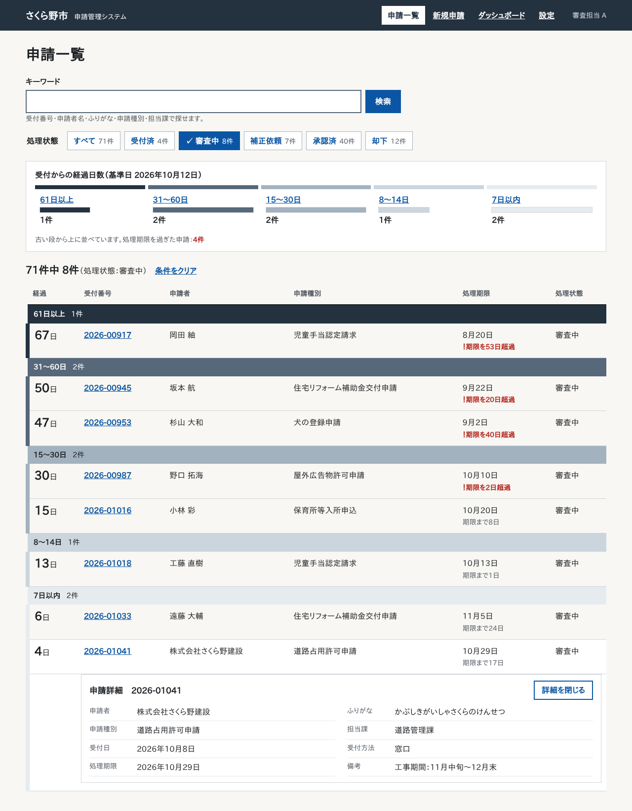
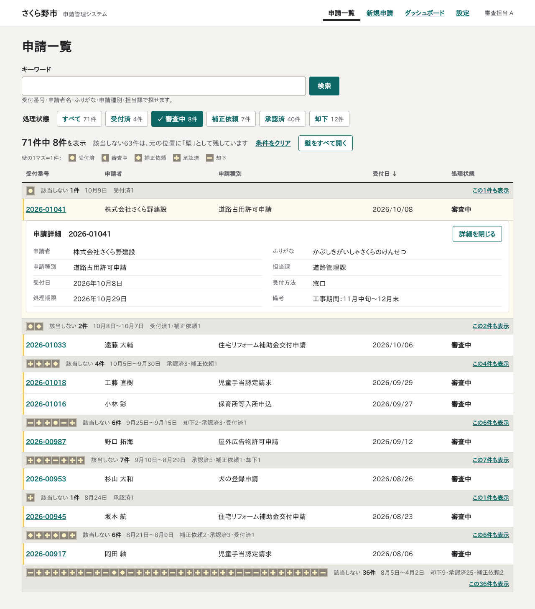
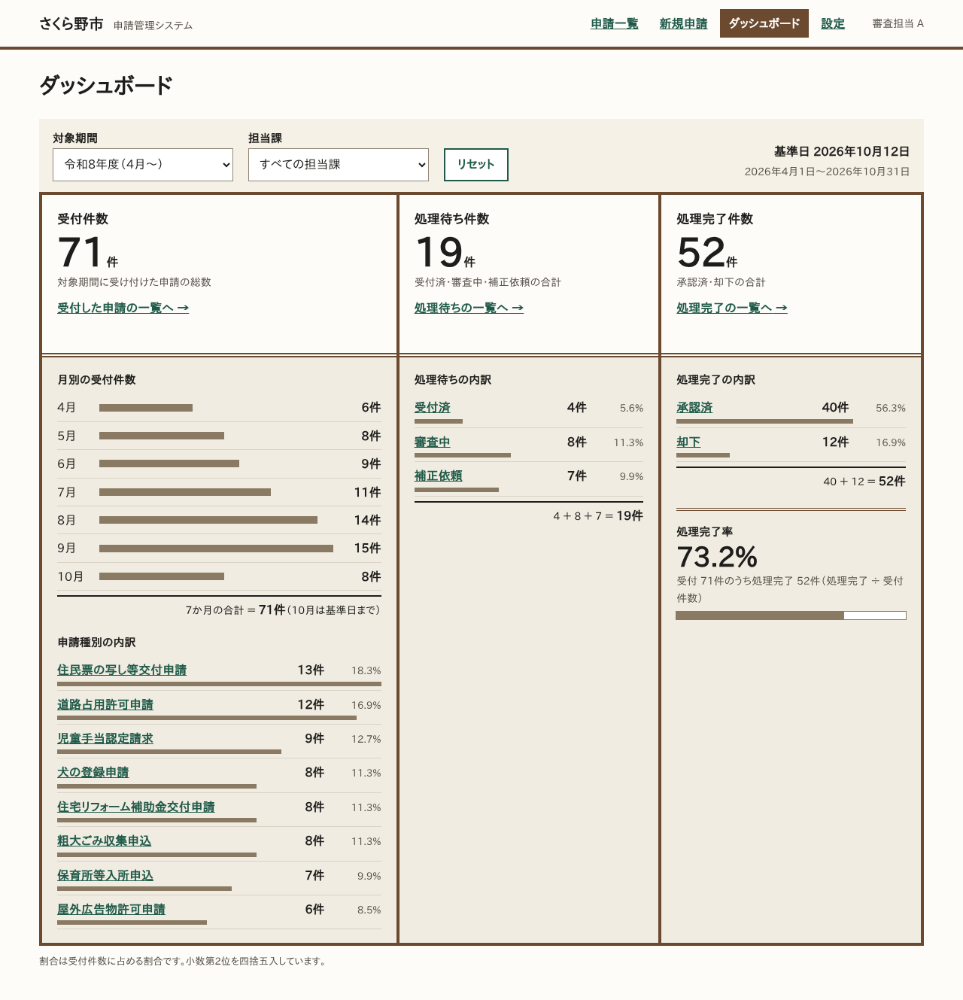

# 独自デザインの追加探索：案E「仕次ぎ」・案F「透かし」・案G「座と裏座」

[前回の探索（案C・D）](../design-exploration/README.md)に続き、採用候補を広げるために主題の異なる3案を作った。名称はすべて仮称。前回より制作量を減らし、**各案の特色が最もよく出る画面を1枚ずつ**（1280px）作った。比較サイト本体・既存の9デザイン・案C・D の資料は変更していない。各案の規則と他画面への展開は[設計資料](concepts.md)にまとめた。

## 代表画面

| 案 | 着想 | 代表画面 | 設計の核 |
| --- | --- | --- | --- |
| 案E 仕次ぎ | 泡盛の古酒を育てる「仕次ぎ」（沖縄） | [申請一覧](images/e-list-1280.png) | 経過した時間で段を分け、古い段を上に置く |
| 案F 透かし | 花ブロック（沖縄） | [申請一覧](images/f-list-1280.png) | 絞り込みで外れた記録を消さず、「透かしの壁」として元の位置に残す |
| 案G 座と裏座 | 伝統的な民家の間取り（沖縄） | [ダッシュボード](images/g-dashboard-1280.png)（[375px](images/g-dashboard-375.png)） | 数値の真下に、その内訳と合計式を同じ列で置く |

案E・F の一覧は、案C・D の一覧と同じ条件（処理状態「審査中」で 71件中 8件、2026-01041 の詳細を開く）で作った。案G は、特色が集計の組み立てにあるためダッシュボードを選んだ（令和8年度・すべての担当課、案C・D のダッシュボードと同じ条件）。値はすべて共通モデルから生成している。

| 案E 仕次ぎ（申請一覧） | 案F 透かし（申請一覧） |
| --- | --- |
| [](images/e-list-1280.png) | [](images/f-list-1280.png) |

| 案G 座と裏座（ダッシュボード） | 比べる相手 |
| --- | --- |
| [](images/g-dashboard-1280.png) | 同じ画面の案C：[一覧](../design-exploration/images/c-list-1280.png)・[ダッシュボード](../design-exploration/images/c-dashboard-1280.png)<br>同じ画面の案D：[一覧](../design-exploration/images/d-list-1280.png)・[ダッシュボード](../design-exploration/images/d-dashboard-1280.png) |

### 案E　仕次ぎ

処理待ちの記録を、受付からの経過日数の段（61日以上〜7日以内）に分け、古い段を上に置く。各行の先頭は経過日数、処理期限は「期限まで n日」「！期限を n日超過」と文字で示す。一覧の上の目盛で段ごとの件数と期限超過の件数を見て、古い段へ直接移れる。段は古いほど深い色にするが、段の名前と順序でも区別できる。この画面では審査中8件のうち4件が期限を過ぎていて、うち3件が上の2段にある。

### 案F　透かし

「審査中」で絞り込んでも、外れた63件を消さない。連続する分を1本の壁にまとめ、受付日の並びの元の位置に残す。壁には件数・日付の範囲・状態ごとの内訳を文字で書き、外れた記録1件ごとに1マスを並べる。マスの透かしの形が処理状態を示す。審査中の8件が受付日の流れのどこにあるかと、いま絞り込み中であることが、壁の存在で常に見える。

### 案G　座と裏座

受付件数・処理待ち件数・処理完了件数を3つの列（座）にし、各列の真下にその内訳（裏座）を置く。内訳の下には「4＋8＋7＝19件」のような合計式を置き、指標と内訳の整合を同じ列で確かめられる。集計条件の帯（縁側）がすべての座に面し、各座の表に一覧への入口が1つある。375px では座を縦に積み、どの座も表→裏の順を保つ。

## 5案の比較

案C・D は3画面×2幅、案E・F・G は代表画面1枚で評価しているため、**展開のしやすさは E・F・G では設計資料に書いた方向からの見込み**である。比べている画面も E・F（一覧）と G（集計）で異なる。

| 観点 | 案C 素地と釉 | 案D 経路と停留所 | 案E 仕次ぎ | 案F 透かし | 案G 座と裏座 |
| --- | --- | --- | --- | --- | --- |
| 整理の原理 | 押せるか／読むだけか | 手続きの順序と分岐 | 経過時間の段 | 外れた記録を位置に残す | 指標の真下に内訳 |
| 「糸の交点」との違い | 明るい地、操作の区別で整理 | 高コントラスト、順序で整理 | 時間の深さで整理 | 絞り込みの見せ方そのもの | 列で表→裏を読む |
| 読みやすさ・密度 | 落ち着いて読める。状態の拾い読みは遅いかもしれない | 状態の位置は明快。路線図の分だけ台帳が下がる | 優先すべき記録が上に来る。段の見出しで行数が増える | 文脈は残るが、行と壁が交互で視線が忙しい | 合計の整合が一目。列の高さがそろわない |
| 操作の見つけやすさ | 呉須色なら押せる | 停留所と「→」 | 目盛の段から移る | 壁ごとの「表示」 | 各座の表に入口が1つ |
| 3画面への展開 | 高（すべて作成済み） | 高（すべて作成済み） | 中（一覧と集計が中心） | 中（フォームのエラーにも応用できる） | 中（集計が中心） |
| 実装負担 | 小〜中 | 中〜大 | 中 | 中〜大 | 小〜中 |
| 状態管理との衝突 | なし（見た目だけ） | 小（状態の追加で図を描き直す） | 中（既定の並びと `sort` の関係、派生値） | 中〜大（壁の開閉という新しい状態、並びとの連動） | なし（既存の集計モデルの配置替え） |
| 別用途・後日の Skill 化 | 高（どのアプリにも効く規則） | 中（状態の流れがある業務） | 中（期限・滞留のある受付台帳） | 中（検索・絞り込みの多い一覧） | 高（指標と内訳を持つ集計全般） |

**各案の長所と弱点（新規3案）**

- **案E**：処理期限という自治体業務の実際の関心に直結し、滞留が上に浮かぶ。一方、一覧の既定の並びを変えるため、比較サイトの「同じ状態を各デザインで比べる」前提（並べ替えの状態の共有）と衝突しやすい。
- **案F**：「絞り込んだまま忘れる」「結果が全体のどこにあるか分からない」という問題に、意匠と機能が一致した答えを出せる。一方、描画と読み上げの設計が最も複雑で、該当が少ない検索では壁が画面の大部分を占める。
- **案G**：既存の集計モデルを配置し直すだけで、状態管理に触れずに実装できる。合計式は意匠を外しても役に立つ。一方、一覧・フォームでの特色は集計ほど強くなく、デザイン全体の個性としてはまだ弱い。

## 第一推奨

**5案の中での第一推奨は、引き続き案C「素地と釉」。** 新規3案の中では **案G「座と裏座」** を推す。

- 比較サイトの第10デザインとして見ると、案C は3画面すべてで規則が効くことを確認済みで、状態管理と衝突しない。
- 新規3案のうち案G は、状態管理に触れずに実装でき、「数値の真下に内訳と合計式」という原則が意匠の説明なしでも成り立つ。一覧・フォームの設計を補えば、案C と並ぶ候補になる。
- 案E・F の原則は、デザインの着せ替えというより**一覧の振る舞いの提案**に近い。比較サイトの共通の並べ替え・絞り込みの状態と衝突しやすいため、第10デザインより、実業務のツール（期限管理・検索の多い台帳）で個別に試す方が価値を確かめやすい。

これは制作者の判断で、採用を決めるものではない。利用者による比較では、次を確かめてほしい。

- 案Eの「経過日数の段」は、受付日の新しい順より実際の作業順に合うか。
- 案Fの壁は、絞り込みの文脈として役立つか、それとも行の読み取りを妨げるか。
- 案Gの「列で内訳を読む」形は、4指標を横に並べる形より報告・照合に向くか。

## 出典と独自意匠の区別

| 案 | 参照した事実（出典） | 画面に持ち込まなかったもの |
| --- | --- | --- |
| E | 古酒は3年以上熟成させた泡盛で、年数を明記した商品が多いこと。1年に1度程度、古酒を少し抜いて若い酒を注ぎ足す「仕次ぎ」（[おきなわ物語「古酒（くーす）って何？」](https://www.okinawastory.jp/feature/awamori/kusu)） | 甕・瓶・酒造所の図や写真。「仕次ぎ＝古い順に処理する」という意味づけはこの案の創作 |
| F | 花ブロックは沖縄の建築に使われる透かし模様のコンクリートブロックで、通気を保ちながら日差しを遮ること（[岐阜女子大学 デジタルアーカイブ研究所](https://digitalarchiveproject.jp/press/%E6%B2%96%E7%B8%84%E3%81%AE%E7%94%9F%E6%B4%BB%E6%96%87%E5%8C%96%E3%80%80%E8%8A%B1%E3%83%96%E3%83%AD%E3%83%83%E3%82%AF/)） | 既存の花ブロックの模様。マスの透かしは丸・半円・ひし形・十字・切れ目の基本図形 |
| G | 民家の縁側から各部屋へ上がれること、一番座〜三番座の裏側に裏座があること（[おきなわ物語「沖縄古民家 ミニ辞典」](https://www.okinawastory.jp/feature/kominka/kominka_jiten)） | 部屋の用途（客間・仏間など）、民家の写真・図面、赤瓦や石垣の意匠 |

3案とも、沖縄全域を代表する様式、伝統工芸や建築の正式な意匠、忠実な再現ではない。参照した説明から、画面の構成の規則だけを取り出した。画像・外部フォント・CDN・API は使っていない。

前回までの案との重なり：出典の花ブロックの記事は名護市役所に触れているが、旧案A「庇と通路」が使った同庁舎のテラス・日陰の区画とは別の性質（透かし）を参照した。案C（壺屋焼）と案E（泡盛）はどちらも甕に関わるが、案C は釉の有無、案E は貯蔵の年数を参照していて、整理の原理が異なる。

## 確認したこと・未確認のこと

- 4枚とも、ページ全体が指定の幅に収まる（横のはみ出し 0px）。外部への通信は0件。
- 件数・項目・状態・内訳は共通モデルから生成した。
- 案E の経過日数・期限までの日数は、基準日（2026年10月12日）と受付日・処理期限から計算した派生値。
- 主な文字のコントラスト比（計算値）：
  - 案E：本文 15.3:1、操作の青 7.3:1、期限超過の赤 6.5:1。
  - 案F：本文 14.4:1、壁の帯の文字 5.5:1、操作 6.7:1。
  - 案G：本文 16.4:1、裏座の補足 6.5:1、操作 6.8:1。
- 未確認：動く操作・キーボード・読み上げ、実際の利用者の評価、Windows の書体での折り返し。撮影環境に BIZ UD フォントがなく、代替のゴシック体で描画している。

## ファイル

```text
docs/design-exploration-2/
├── README.md     この比較
├── concepts.md   案E・F・G の設計資料（最小）
├── images/       代表画面 1280px × 3 と、案G の 375px
└── mock/         静的モック（生成スクリプト、CSS、生成した HTML、撮影スクリプト）
```

作り直すときは、リポジトリのルートで次を順に実行する。

```bash
node docs/design-exploration-2/mock/build.mjs
```

```bash
node docs/design-exploration-2/mock/capture.mjs
```
