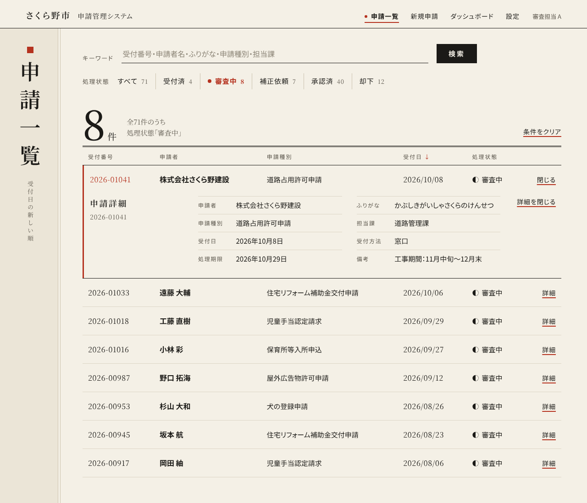
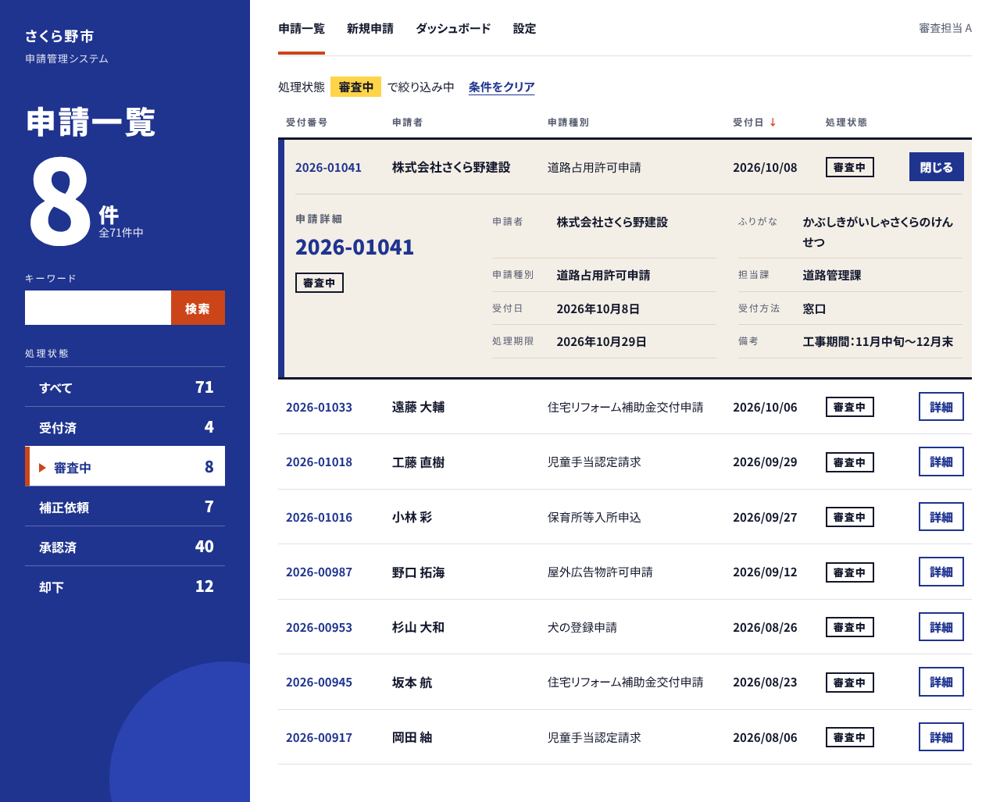
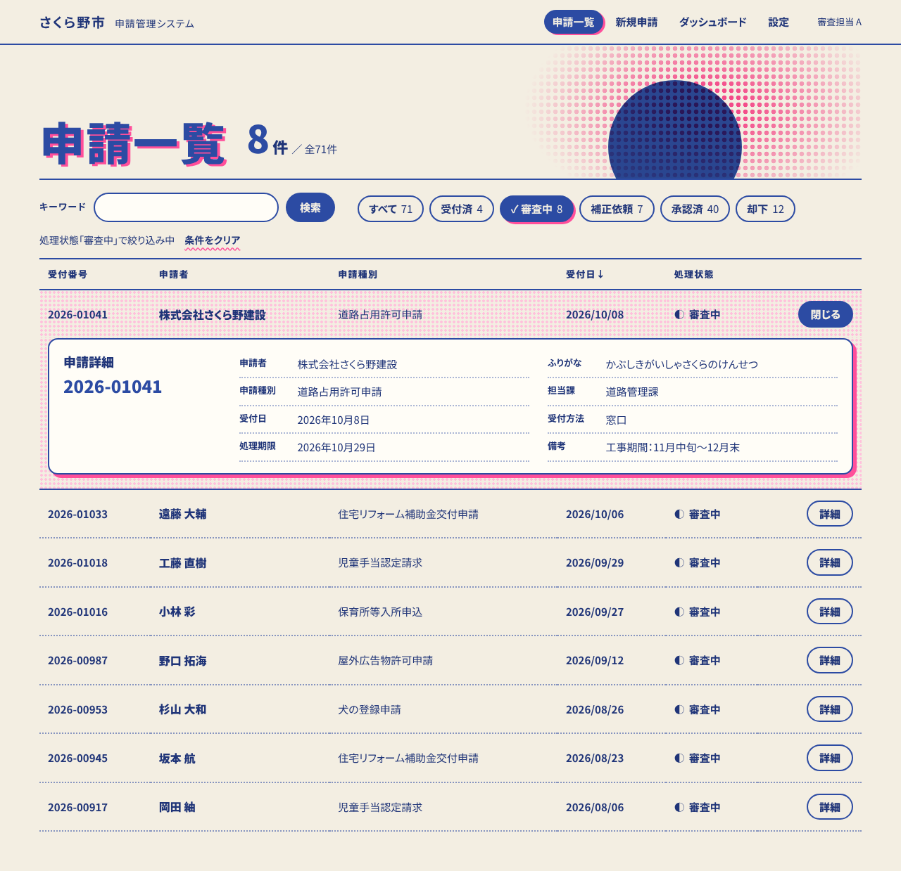

# 視覚デザインの探索（第3回）：申請一覧を3つの見た目で

[README に戻る](../../README.md)

先に画面を見てください。3案とも同じ申請一覧で、比較条件も同じです（幅1280px、処理状態「審査中」で絞り込み＝71件中 8件、2026-01041 の詳細を開いた状態、値は共通モデルから生成）。名称はすべて仮称です。

## 案H　縦組みの台帳

[](images/h-list-1280.png)

## 案I　色面

[](images/i-list-1280.png)

## 案J　二色刷り

[](images/j-list-1280.png)

前回までの一覧と見比べる：[糸の交点](../okinawa-ui-study/site-thread-list-1280.png)・[案C](../design-exploration/images/c-list-1280.png)・[案D](../design-exploration/images/d-list-1280.png)・[案E](../design-exploration-2/images/e-list-1280.png)・[案F](../design-exploration-2/images/f-list-1280.png)

---

## 各案の狙いと所感

### 案H　縦組みの台帳

- **見た目の狙い**：書籍や公文書の組版の静けさ。生成りの紙に墨、朱を一点だけ使う。左の「背」に縦組みの表題を置き、上端には本の柱のような細い帯を通す。件数や受付番号などの数字は明朝体、データ本文はゴシック体。罫は細く、表の上だけ二重罫にする。
- **視覚的に優れていると思う点**：日本語の縦組みと明朝の数字が、他のどの案にもない品のよさと個性を出している。装飾はほぼないのに、表題の背と朱の点だけで画面が引き締まる。行間が広く、行政の台帳として違和感がない。
- **気になる点**：
  - 静かな分、第一印象の強さは「糸の交点」に及ばないかもしれない。
  - 処理状態の絞り込みが文字だけの並びなので、押せることが伝わりにくい。選択中は朱の丸と色で示している。
  - 明朝の見え方は端末の書体に左右される（下記）。

### 案I　色面

- **見た目の狙い**：群青の大きな色面と白い作業面の対比。表題と件数「8」を極太の大きな数字で色面に置き、処理状態の選択肢を色面の中に縦に積む。朱と黄を一点ずつ使う（主ボタンと現在地、絞り込み中の条件）。
- **視覚的に優れていると思う点**：遠くからでも「いま8件を見ている」が分かる、ポスターのような強さがある。色面と白の境がはっきりしていて、条件（左）と記録（右）の役割分担が見た目だけで伝わる。
- **気になる点**：
  - 左に色の付いたサイドバーを置く構成は、一般的な業務アプリにもよくある。個性は数字の大きさと配色に依存している。
  - 作業面が狭くなり、長い申請種別は折り返しやすい。
  - 色面の右下の円は飾りで、意味はない。

### 案J　二色刷り

- **見た目の狙い**：生成りの紙に青と蛍光ピンクの2色だけで刷った印刷物の手触り。重なりは掛け合わせで濃くなる。表題はピンクの版を少しずらした「版ずれ」、見出しの右に網点のにじみと青い円、開いた行は細かな網点の地にする。
- **視覚的に優れていると思う点**：3案の中で最も独自性が強く、ひと目で覚えられる。2色に絞っているので、にぎやかでも散らからない。罫を点線にしたことで、表が軽く見える。
- **気になる点**：
  - 行政の業務画面としては軽く、遊びが強すぎると受け取られる可能性が高い。
  - 本文も青で刷っているため、長時間の照合では黒より疲れるかもしれない（青墨と紙は 10.0:1）。
  - ピンクは文字の地に使わず、選択は青の塗りにピンクのずれた影で示した。網点と円は装飾。

## 今回の所感

- 3案は配色だけでなく、文字組み・余白・線と面・数字の扱いで方向が異なる。
- **制作者として最も残したいのは案H**。日本語の文字組みそのものが見た目の魅力になっていて、行政の画面として無理がない。ただし第一印象の強さで「糸の交点」を超えているかは、利用者の目で判断してほしい。
- 案I は強いが、構成の新しさは小さい。案J は独自だが、用途を選ぶ。
- 3案のどれにも採用したいほどの魅力を感じなければ、**今回は見送ってよい**と考える。その場合も、案H の「縦組みの表題と明朝の数字」、案J の「2色の掛け合わせ」は、次の探索の素材として使える。

## 実務上の最低条件の確認

- 3案とも、キーワード・処理状態の絞り込み・件数・台帳・詳細・「詳細／閉じる」が同じ画面にある。
- 処理状態は文字（と ○◐ などの記号）で示し、色だけに頼っていない。選択中の絞り込みは、色に加えて ●・▶・✓ の形でも示している。
- 主な文字のコントラスト比（計算値）は次のとおり。
  - 案H：墨と紙 15.3:1、補足 6.3:1、朱の文字 5.4:1。
  - 案I：白と群青 10.8:1、墨と黄 12.6:1、主ボタンの白文字 4.7:1。
  - 案J：青墨と紙 10.0:1、青の文字 6.9:1。
- 3枚とも、ページ全体が1280pxに収まる（横のはみ出し 0px）。外部への通信は0件（画像・外部フォント・CDN なし）。
- **未確認**：
  - 375px・フォーム・ダッシュボード（今回は作らない）。
  - 動く操作とキーボードの確認。
  - 実際の端末の書体での見え方。撮影には Noto Serif／Sans CJK JP を使った。指定は BIZ UD・ヒラギノ・游書体が先なので、Windows や Mac では字形と字幅が変わる。

## ファイルと作り直し方

`mock/` に生成スクリプト（`build.mjs`）・3案の CSS・生成した HTML・撮影スクリプト（`capture.mjs`）、`images/` に3枚の画像を置いた。リポジトリのルートで次を順に実行すると作り直せる。

```bash
node docs/design-exploration-3/mock/build.mjs
```

```bash
node docs/design-exploration-3/mock/capture.mjs
```
