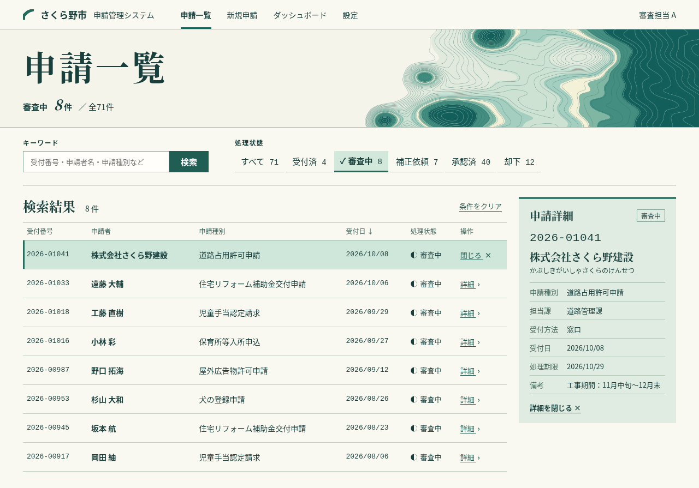
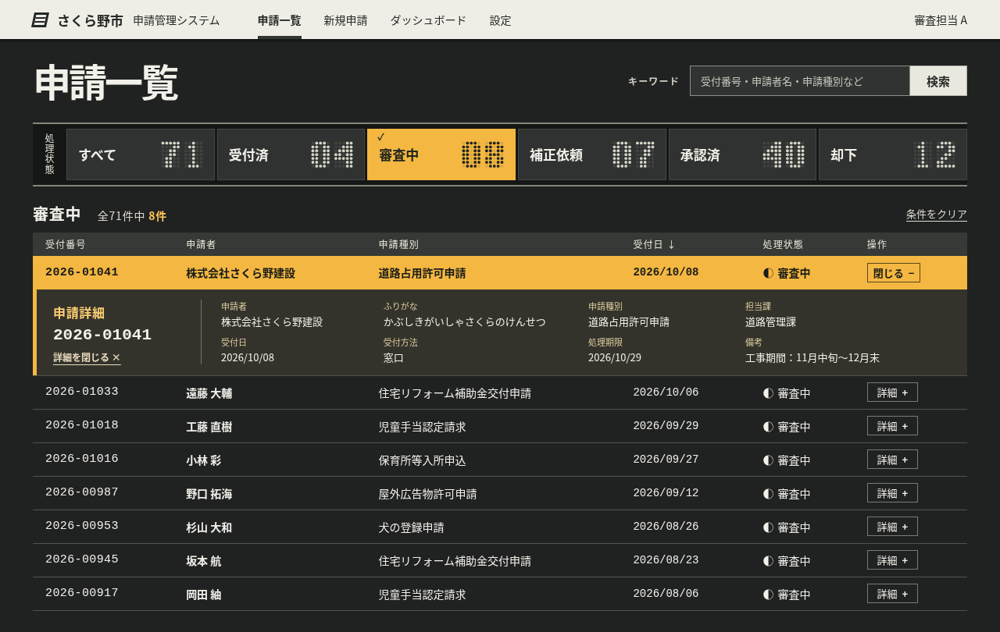

# 申請一覧の視覚探索　汀線・標示盤

### K　汀線

### L　標示盤

どちらも幅1280px。共通モデルの71件を「審査中」で絞り込み、受付日が新しい順に8件を表示した。開いているのは受付番号 `2026-01041` の道路占用許可申請。

**既存案の申請一覧を原寸で開く**　[H「縦組みの台帳」](../design-exploration-3/images/h-list-1280.png) ／ [J「二色刷り」](../design-exploration-3/images/j-list-1280.png) ／ [「糸の交点」](../okinawa-ui-study/site-thread-list-1280.png)

### K の見どころ

象牙色の余白から深緑の水際が現れる横長の構図に、払いの長い明朝の「申請一覧」を置いた。いちばん残したいのはこの案。見出しを離れると、水際の淡い緑が選択行と右の詳細にだけ広がり、8件の並びを保ったまま1件を照合できる。弱点は右欄との視線の往復で、下の行を選ぶほど行と詳細の距離が開く。

### L の見どころ

処理状態の切り替えを一続きの標示盤にした。件数は桁の位置が揃うドット文字、申請者名と日付は輪郭のくっきりした活字で組んだ。「審査中 08」と選択行を同じ琥珀色で拾え、その真下で受付日と処理期限を見比べられる。状態別の件数が主役になるぶん、個々の申請者を順に探す仕事には盤面の主張が強い。
