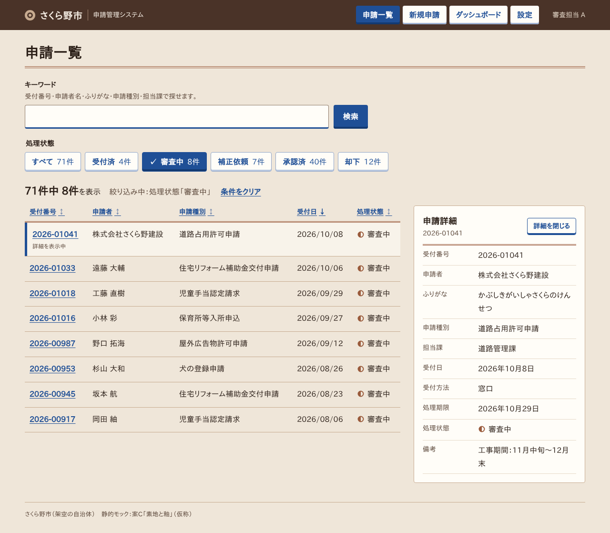
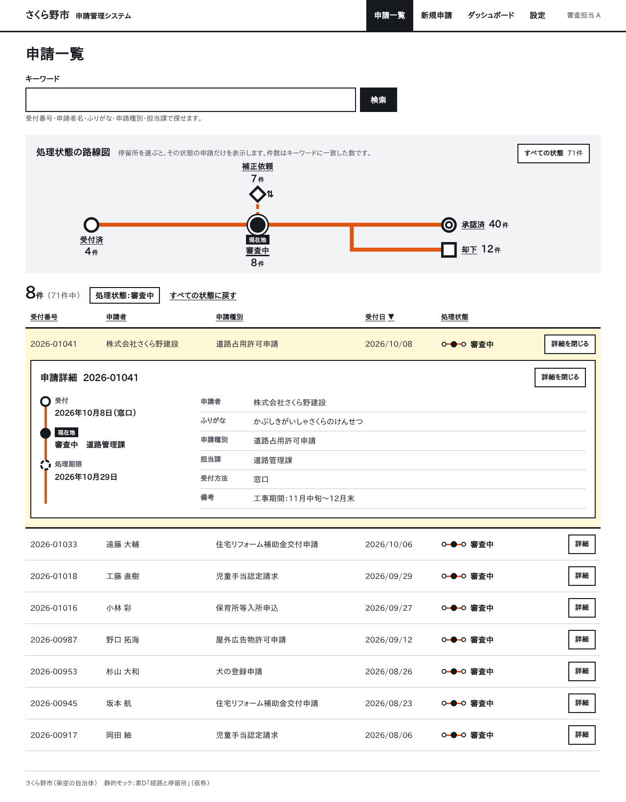
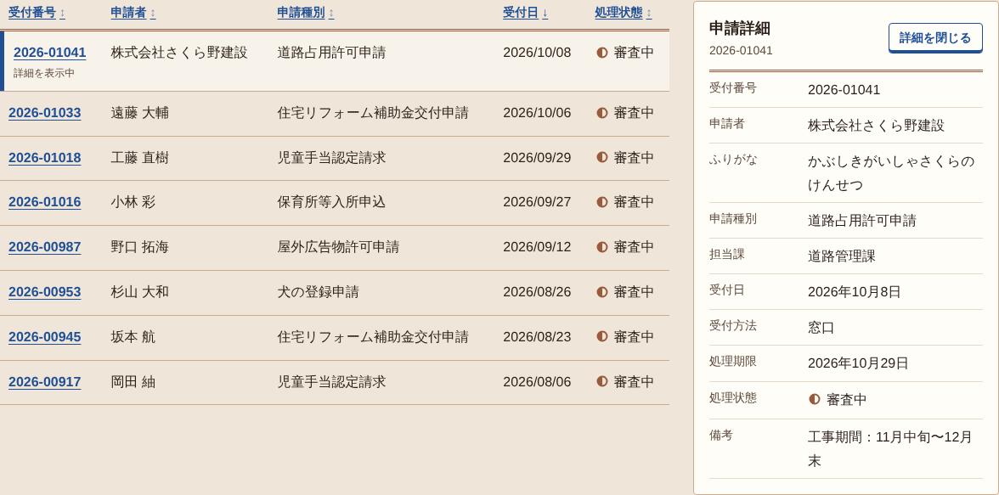
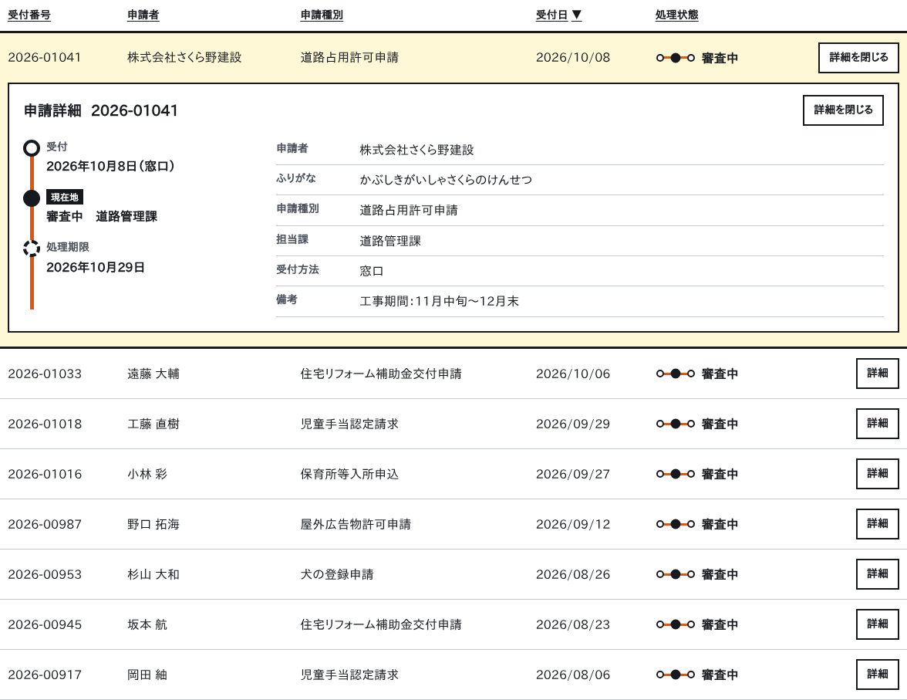
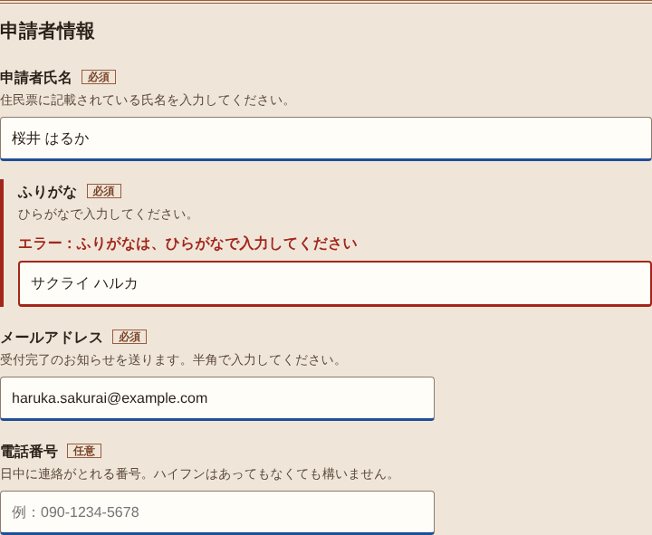
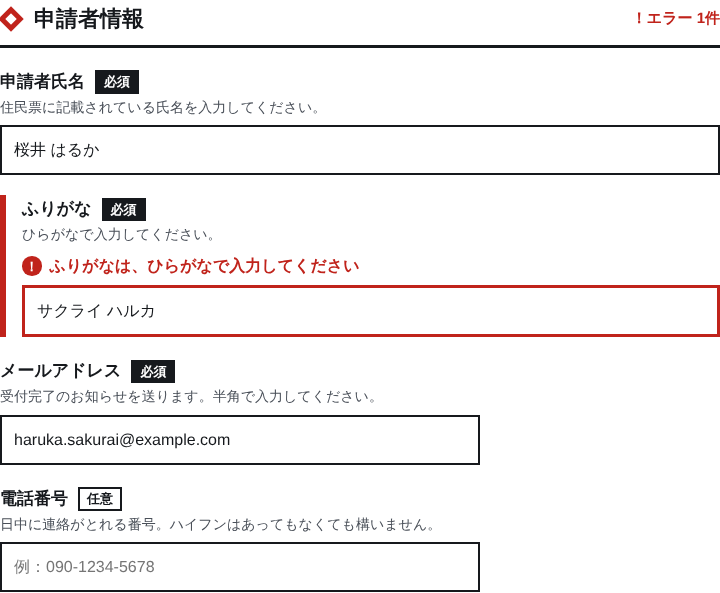
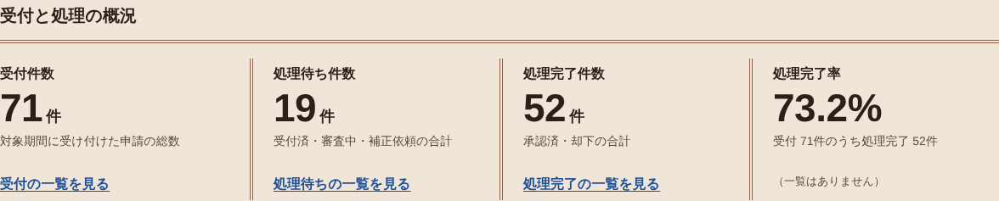
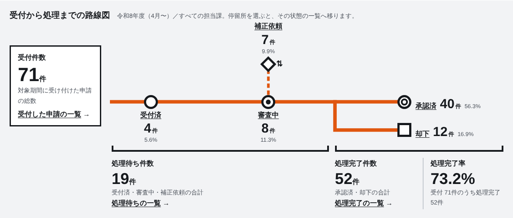

# 新しい独自デザインの探索：案C「素地と釉」と案D「経路と停留所」

「糸の交点」の次の独自デザインとして、設計担当（Claude Opus）が主題の異なる2案を作った。どちらも名称は仮称。ここにあるのは**静的なモックと設計資料だけ**で、比較サイト本体・既存の9デザイン・既存の試作には組み込んでいない。利用者が1案を選んだ後、選んだ案の設計資料を正本として、別の担当が動く実装を作る。

- 案C **素地と釉（きじとくすり）**：沖縄の壺屋焼の「荒焼」と「上焼」の区別から、**押せるものだけに釉（白い面と呉須の色）を掛ける**。→ [設計資料](concept-c.md)
- 案D **経路と停留所**：公共交通の案内表示の考え方から、**処理状態を路線として描き、現在地と次の行き先を示す**。沖縄以外の主題（理由は後述）。→ [設計資料](concept-d.md)

## 12画面を見比べる

比較条件は両案で同じ（値はすべて共通モデルから生成）。

- **申請一覧**：処理状態「審査中」で絞り込み（71件中 8件）、2026-01041 の詳細を開いた状態
- **新規申請**：共通の正常な入力例から、ふりがなをカタカナに、電話を空欄（任意）に、同意を外して「確認へ」を押した直後（エラー2件、まとめにフォーカス）
- **ダッシュボード**：令和8年度・すべての担当課（受付71件・処理待ち19件・処理完了52件・処理完了率73.2%）

| 申請一覧・1280px | |
| --- | --- |
| 案C | 案D |
| [](images/c-list-1280.png) | [](images/d-list-1280.png) |

| 画面 | 幅 | 案C 素地と釉 | 案D 経路と停留所 |
| --- | --- | --- | --- |
| 申請一覧 | 1280px | [c-list-1280](images/c-list-1280.png) | [d-list-1280](images/d-list-1280.png) |
| 申請一覧 | 375px | [c-list-375](images/c-list-375.png) | [d-list-375](images/d-list-375.png) |
| 新規申請 | 1280px | [c-form-1280](images/c-form-1280.png) | [d-form-1280](images/d-form-1280.png) |
| 新規申請 | 375px | [c-form-375](images/c-form-375.png) | [d-form-375](images/d-form-375.png) |
| ダッシュボード | 1280px | [c-dashboard-1280](images/c-dashboard-1280.png) | [d-dashboard-1280](images/d-dashboard-1280.png) |
| ダッシュボード | 375px | [c-dashboard-375](images/c-dashboard-375.png) | [d-dashboard-375](images/d-dashboard-375.png) |

## 案C　素地と釉（仮称）

**参照した事実。** 「やちむん」は沖縄の言葉で焼物のこと。壺屋焼は大きく荒焼と上焼に分かれる。荒焼は釉薬をかけずに約1120度で焼き、装飾はほとんどなく陶土の風合いを活かしたもので、酒甕・水甕・壺など大型の容器が中心。上焼は赤土に白土で化粧がけをしたり釉薬をかけたりして約1200度で焼き、釉薬には水漏れを防ぎ汚れをつきにくくする効果もあるため、食器・酒器・花器など日用品が多い。（[おきなわ物語「やちむんとは」](https://www.okinawastory.jp/feature/yachimun/whatisyachimun)）

**画面への翻訳。** 「日常で手に取る器に釉を掛ける」を、**手で触れる（操作する）ものにだけ釉を掛ける**という規則にした。リンク・ボタン・入力欄・選択肢は白化粧の面と呉須の色を持ち、下端に濃い「釉だまり」を付ける。記録の値・件数・見出し・グラフは陶土色の地に鉄色の文字のままにし、角も丸めない。呉須色のものは必ず押せ、押せるものは必ず呉須色を持つ。区切りは二本の細い刻線（線彫り）、処理状態は色を使わない窯印のような形（○ ◐ △ ● ×）と文字で示す。

**情報の整理と導線。** 一覧は「棚」（台帳）と「盆」（選んだ記録の詳細を右に置き、台帳を見たまま照合する）。フォームはPCでも1列で、余白を広く取る。集計は数値を箱に入れず、線彫りで区切った1列の並びにし、一覧への入口だけを呉須のリンクにする。

**向く画面と弱点。** 初めて使う住民も毎日使う職員も「どこを押せるか」を迷わない。規則が単純なので、実装後も守られているかを確かめやすい。一方、状態に色を使わないため、多数の行から「補正依頼」を素早く拾う作業は色分けより遅いかもしれない。生成りと茶の地は、長時間の照合で沈んで見える可能性がある。

## 案D　経路と停留所（仮称）

**沖縄以外にした理由。** 申請管理の中心は「受付→審査→（補正依頼で戻る）→承認／却下」という手続きの順序で、職員が知りたいのは「どこで何件止まっているか」である。この順序と分岐を骨格にすると、一覧の絞り込み・集計の内訳・フォームの進み具合を同じ図法で読める。この効用は地域の主題からではなく、移動を案内する表示の考え方から直接導ける。沖縄の主題は案Cで扱った。

**参照した事実。** 国土交通省の旅客施設のガイドラインは、サインを誘導・位置・案内・規制の4種に分けて動線に沿って配置すること、誘導サインを動線の分岐点などに置くこと、路線などを色で表す場合も文字を併記するなど色だけに頼らないこと、現在位置を赤で示す場合は下線や反転文字など形でも変化をつけることを挙げている。（[バリアフリー整備ガイドライン（旅客施設編）2. 誘導案内設備に関するガイドライン（PDF）](https://www.mlit.go.jp/sogoseisaku/barrierfree/content/001913508.pdf)）

**画面への翻訳。** 処理状態を、形の異なる停留所が橙の線でつながった路線図にした（受付済→審査中→承認済、審査中から却下への分岐、審査中と行き来する補正依頼の支線）。一覧では路線図の停留所が状態の絞り込みになり、台帳の各行には経路上の位置を3点で示す。フォームは左に「入力の経路」を置き、区間（入力のまとまり）ごとに「✓ 入力済」「！エラー1件」を出す。集計は4指標を路線図に組み込み、分岐の手前を「処理待ち19件」、先を「処理完了52件・73.2%」で括る。月別・種別は1マス＝1件。現在地は黒地に白字の反転、次の操作は「→」、エラーは赤の反転見出し。

**向く画面と弱点。** 滞留の場所と補正依頼の戻りが一目で分かり、3画面が同じ図で結ばれる。一方、路線図が一覧の上で約200〜240pxを使い、台帳の始まりが下がる。状態が増えると図を描き直す必要がある。「路線」の比喩が業務画面として軽く見える可能性もある。

## 本文だけで比べる

上部の帯と画面名を除き、本文の一部を同じ幅で切り出した。

| 部分 | 案C | 案D |
| --- | --- | --- |
| 一覧（台帳と詳細） | [](images/body-list-c.png) | [](images/body-list-d.png) |
| 入力（申請者情報） | [](images/body-form-c.png) | [](images/body-form-d.png) |
| 集計（4指標） | [](images/body-dashboard-c.png) | [](images/body-dashboard-d.png) |

## 既存の3案との違い（色以外）

| 観点 | 彩 | 庇と通路（旧案A） | 糸の交点（旧案B） | 案C 素地と釉 | 案D 経路と停留所 |
| --- | --- | --- | --- | --- | --- |
| 整理の軸 | 処理状態の索引と台帳 | 庇の下の作業区画 | 章・項目名・値の縦横の軸 | 押せるか／読むだけか | 手続きの順序と分岐 |
| 状態の表し方 | 索引の選択と色 | （一覧の案なし） | 色の札と文字 | 形の印と文字（色なし） | 停留所の形・経路上の位置と文字 |
| 詳細の位置 | 行の直下 | 庇の内側 | 行の直下、同じ軸 | PCは右の盆、狭い幅は直下 | 行の直下、この申請の経路付き |
| フォーム | 関連項目を隣り合わせ | 左右2区画＋全幅の同意 | 章・項目名・入力の横並び | 1列、広い余白 | 左に入力の経路、区間ごとの状態 |
| 集計 | 4つの区画と棒 | 一つの庇の下に4数値 | 行型の指標と横棒 | 箱のない数の並び、土色の棒 | 路線図に指標を組み込み、1マス＝1件 |
| 地と装飾 | 白と砂色、見出し右の幾何模様 | 明色、庇の略図 | 濃藍、十字の模様と格子帯 | 陶土色、模様なし（刻線と印だけ） | 白と灰の案内パネル、模様なし |

## 2案の比較

| | 案C 素地と釉 | 案D 経路と停留所 |
| --- | --- | --- |
| 設計の核 | 操作の手がかりを1つの規則にまとめる | 手続きの順序を画面の骨格にする |
| 3画面の一貫性 | 規則がすべての部品に効く | 同じ路線図が一覧・フォーム・集計に出る |
| 強み | 押せる場所に迷わない。規則を守れているかを自動で確かめやすい。部品が単純 | 滞留と戻りが見える。エラーの区間から該当箇所へ移れる。集計と一覧の入口が一体 |
| 弱み | 状態の拾い読みが遅いかもしれない。茶系の地は沈んで見える可能性 | 路線図の高さ。状態の追加に弱い。比喩が軽く見える可能性 |
| 実装の難しさ | 小〜中。既存の部品の見た目を作り替える | 中〜大。路線図（SVGの線＋配置したボタン）の幅対応と操作順 |
| 前回（糸の交点）との差 | 明るい地。軸ではなく操作の区別で整理 | 高コントラストの案内表示。状態の順序で整理 |
| 沖縄との関係 | 壺屋焼の工程上の区別を参照 | なし（理由は上記） |

## 第一推奨

**案C「素地と釉」を第一に推す。**

1. 第一希望の沖縄の主題を、一次情報で確かめられる工程上の区別（荒焼と上焼）から、操作の規則に翻訳できた。模様や観光の記号に頼っていない。
2. 「呉須色なら押せる」という規則は、住民向けの申請と職員向けの台帳の両方に効く。画面が増えても破綻しにくい。
3. 実装と検証の負担が小さい。比較サイトの既存の部品構成（検索・選択肢・台帳・詳細・フォーム・集計）をそのまま着せ替えられる。
4. 「糸の交点」（濃藍・軸で読む）と、地の明るさも整理の原理も異なる。

**案Dを選ぶ方がよい場合。** 処理の滞留と補正依頼の戻りを見つけることを最優先にするなら、案Dの方が直接役に立つ。案Cを採用する場合でも、案Dの「状態の位置を3点で示す」「エラーの区間を経路に出す」は部分的に借りられる。

## 選ぶときに確かめたいこと

- 職員が台帳で「補正依頼」を探すとき、色のない印（案C）で困らないか。
- 路線図が一覧の上で使う高さ（案D）を、毎日の作業で許容できるか。
- 生成りと茶の地（案C）、白と黒と橙（案D）が、組織の他のシステムと並べたときに浮かないか。
- 「どこを押せるか」と「いまどこにいるか」のどちらを、より大きな課題と感じているか。

## 出典と独自意匠の区別

- **案C**：参照したのは壺屋焼の荒焼・上焼の区別と、釉薬の効用の説明だけ。沖縄では壺屋焼のほかにも各地でやちむんが作られてきた（同じ出典が古我知焼・喜名焼・八重山焼などを挙げている）。この案は沖縄全域の代表様式でも、壺屋焼の公式な意匠でもない。色は画面のための選色で、器の測色値ではない。器の写真、特定の陶工や窯元の図柄（魚紋・唐草など）、ロゴは使っていない。輪の印、状態の印、刻線はすべて基本図形から作った。
- **案D**：参照したのは国のガイドラインに書かれたサインの考え方だけ。実在の事業者の路線色、駅ナンバリング、案内用図記号（JIS Z 8210）の図形は使っていない。
- 両案とも画像・外部フォント・CDN・APIを使わない。

## 確認したこと・未確認のこと

**確認したこと（モックの範囲）**

- 件数・割合・選択肢・項目名・エラー文は、生成スクリプトが共通モデル（`buildModel`・`buildFormModel`・`validate`・`buildDashboardModel`）から作っている。手書きの値はない。
- 12画面とも、ページ全体が指定の幅に収まる（横のはみ出し 0px）。外部への通信は0件。
- 主な文字と地のコントラスト比（計算値）は次のとおり。
  - 案C：本文 12.9:1、補足 6.8:1、呉須の文字 6.5:1（素地上）・7.9:1（白化粧上）、主ボタンの白文字 8.0:1、エラー 6.0:1。
  - 案D：本文 17.6:1、補足 8.1:1、エラー 6.0:1、路線の線 3.8:1（非文字）。
  - その他の色は各設計資料の表にある。

**未確認のこと**

- 動く操作（キーボード、IME、読み上げ、幅の変更）は静止画では確かめていない。設計資料に意図を書いた。
- 実際の利用者による見え方・速さ・地域の印象。色覚の多様性のシミュレーション。
- 撮影環境に BIZ UD フォントがなく、日本語は代替のゴシック体で描画した。Windows の書体では字幅と折り返しが変わる。
- 確認画面・完了画面はモックを作っていない（設計資料に構成を書いた）。

## ファイルと作り直し方

```text
docs/design-exploration/
├── README.md        この比較
├── concept-c.md     案Cの設計資料（実装担当向け）
├── concept-d.md     案Dの設計資料（実装担当向け）
├── images/          12画面と本文の比較画像
└── mock/            静的モック（生成した HTML、CSS、生成・撮影スクリプト）
```

モックを作り直すときは、リポジトリのルートで次を順に実行する（既存の `@playwright/test` の Chromium を使う）。

```bash
node docs/design-exploration/mock/build.mjs
```

```bash
node docs/design-exploration/mock/capture.mjs
```

生成した HTML（`mock/*.html`）は `file://` で直接開ける。比較サイトのテスト・公開物には含まれない。
