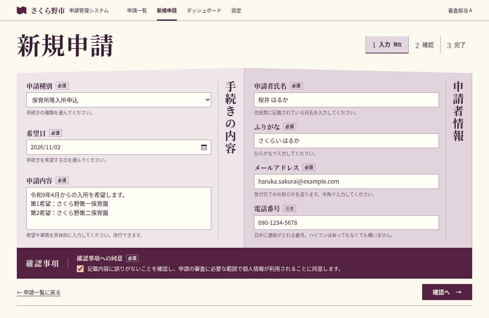
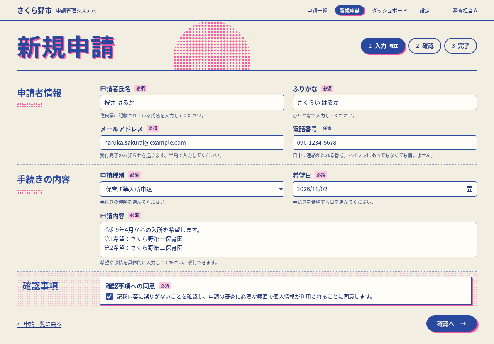
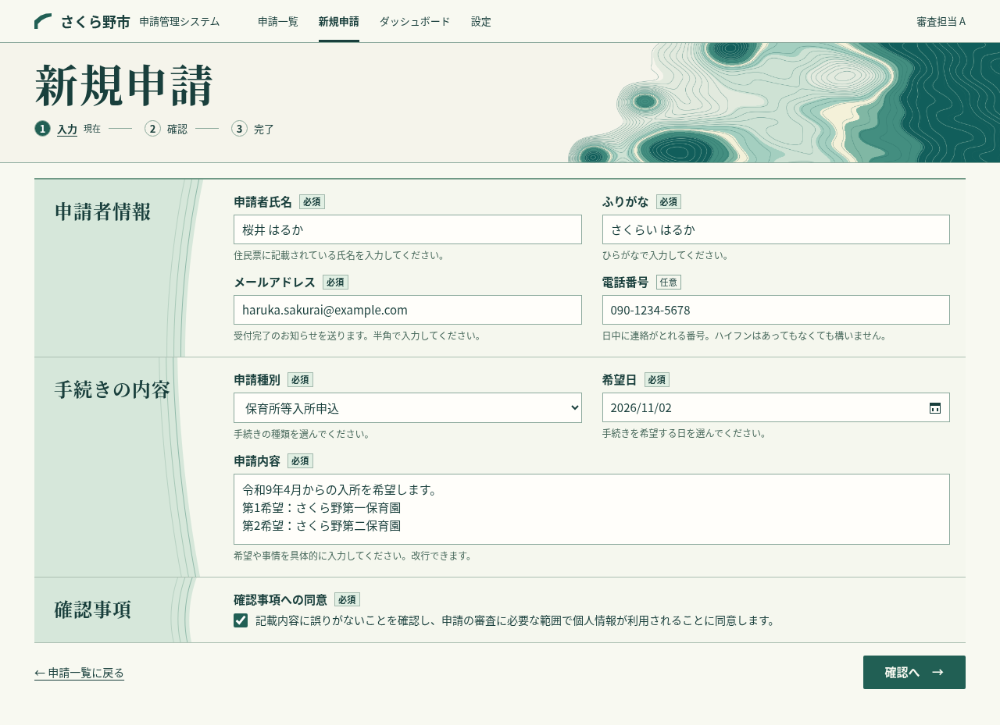
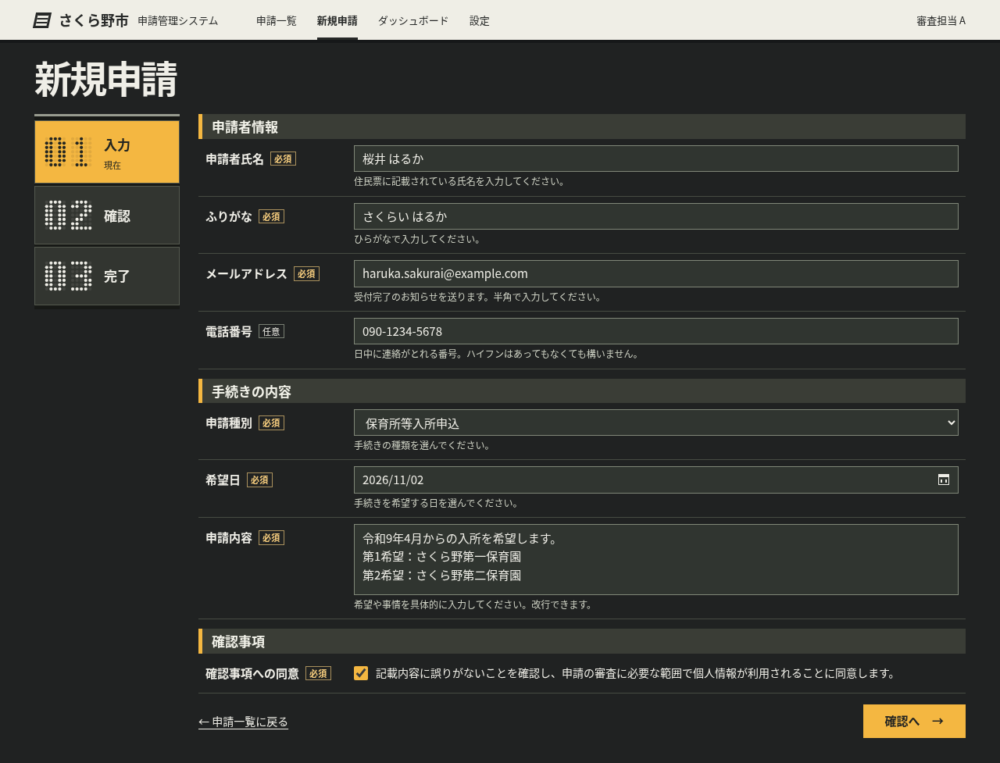

# 新規申請フォームの比較

4案とも幅1280px、全3ステップの最初の「入力」。さくら野市の共通入力例 `FORM_SAMPLES.valid` を使い、桜井はるかさんの保育所等入所申込を、同意済み・エラーなしで表示した。各画像をクリックすると原寸で開く。

| H′「折本」 | J「二色刷り」 |
| --- | --- |
|  |  |
| **K「汀線」** | **L「標示盤」** |
|  |  |

同じ入力例を使った比較基準も原寸で開ける。[「糸の交点」の新規申請フォーム](../okinawa-ui-study/site-thread-form-1280.png)

## 一覧からフォームに移したときの見え方

- **H′「折本」**　一覧で一件ずつ開いた紙面を、右の「申請者情報」と左の「手続きの内容」の見開きにした。長いメールアドレスも申請内容も横書きのまま読める。右の紙面から書き始める順序は、横書きのフォームに慣れているとつかみにくい。[申請一覧](../h-prime/images/h-prime-list-1280.png)
- **J「二色刷り」**　見出しの版ずれと選択行の網点を、現在の手順、同意欄、確認ボタンへ移した。網点に囲まれた白い面で、最後に読む同意文を拾いやすい。その一方、同意欄のピンクの縁と直下の確認ボタンは、近くに並ぶと目立ち方が競合する。[申請一覧](../design-exploration-3/images/j-list-1280.png)
- **K「汀線」**　水際の曲線を章見出しと入力面の境目に通した。どの章でも同じ位置から白い欄が始まり、申請内容の改行まで静かな地の上で読める。同意だけの短い章にも左側を広く取るため、そこでは余白がやや勝つ。[申請一覧](../design-exploration-4/images/k-list-1280.png)
- **L「標示盤」**　状態別件数を示していたドット数字を手順番号に使い、現在の「01 入力」と確認ボタンを琥珀色で結んだ。欄が一列なので、入力値からすぐ下の補足へ目を運びやすい。短い電話番号や日付にも一行を使うぶん、同意と主操作までの縦の距離は長い。[申請一覧](../design-exploration-4/images/l-list-1280.png)

4案とも継続して比較する。
