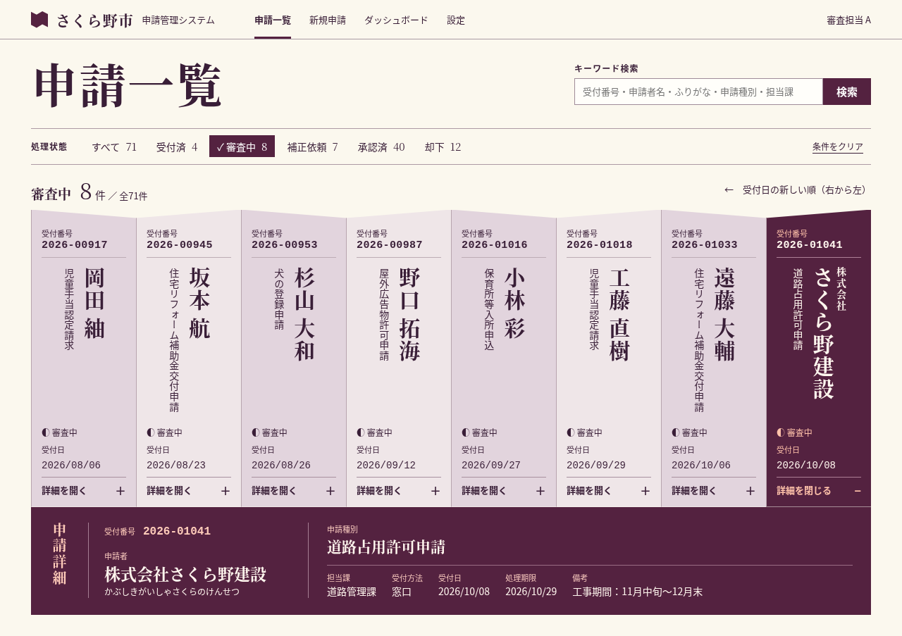

# H′「折本」

**原寸で見比べる**　[現行H「縦組みの台帳」](../design-exploration-3/images/h-list-1280.png) ／ [J「二色刷り」](../design-exploration-3/images/j-list-1280.png) ／ [K「汀線」](../design-exploration-4/images/k-list-1280.png) ／ [L「標示盤」](../design-exploration-4/images/l-list-1280.png) ／ [「糸の交点」](../okinawa-ui-study/site-thread-list-1280.png)

現行Hで表題の背に使った縦組みを、一件ごとの申請へ移した。申請者名は太い明朝、その脇の申請種別は細いゴシック。紙の上辺に交互の傾きをつけ、右から左へ八面がひと続きに開く形にした。

右端の一面を選ぶと、その葡萄色が下段まで続く。縦に読んだ「さくら野建設」を横組みの詳細で受け直し、受付日と処理期限を隣り合わせで照合できる。弱点は一覧性が横幅に左右されること。件数が増えたときや、長い法人名が続くときの探しやすさは検証が必要になる。

比較条件は幅1280px、全71件のうち審査中の8件。右端が最新の受付で、`2026-01041` の詳細を開いている。
