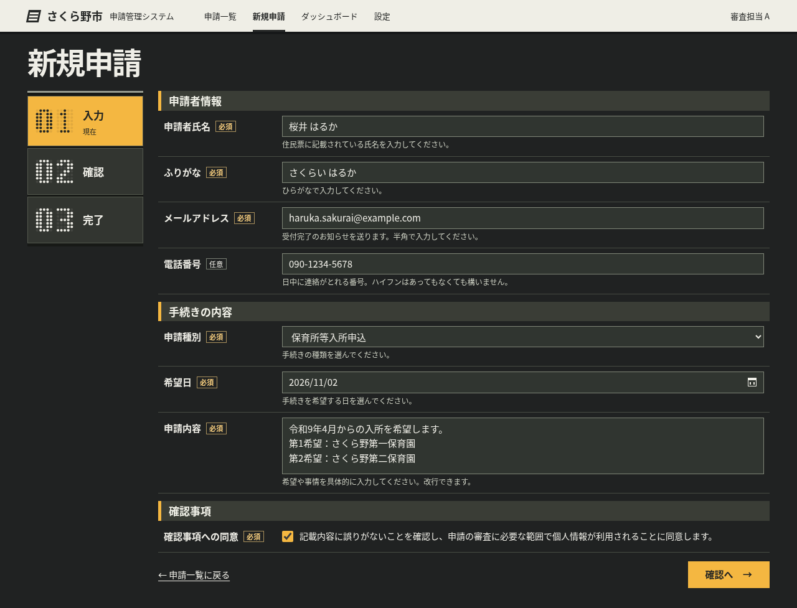
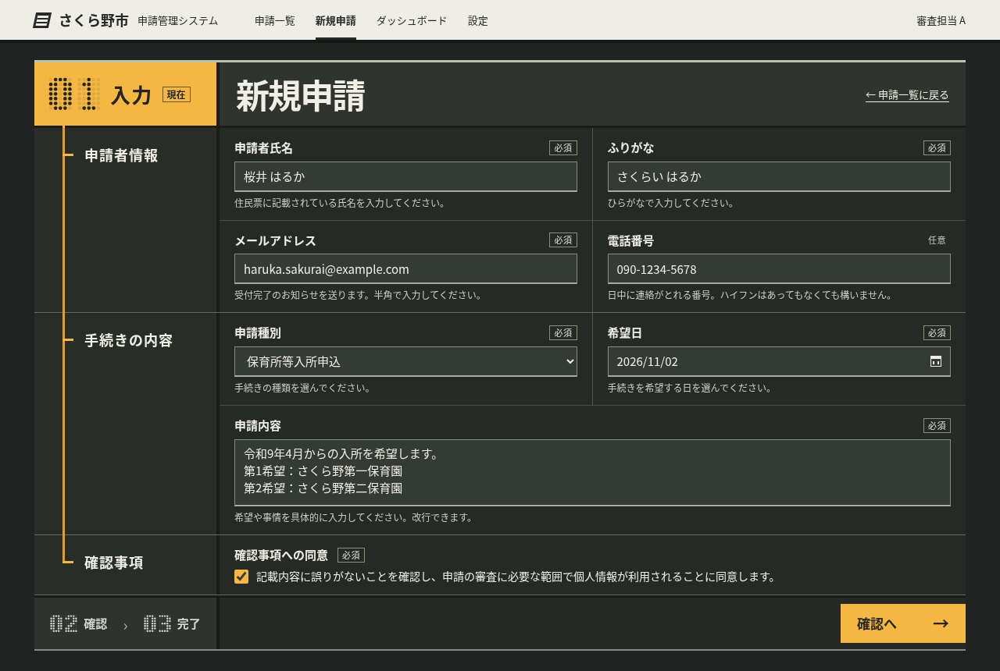

# L「標示盤」新規申請フォームの再設計

| 現行L | L改良案 |
| --- | --- |
|  |  |

両方とも幅1280px。「入力」ステップで同じ保育所等入所申込の8項目を表示し、同意にチェックが入った状態。画像を選ぶと原寸で開く。

**変えた点**　現行版で左に並んでいた手順を、改良案では上端の「01 入力」と下端の「02 確認」「03 完了」に分けた。「01 入力」から伸びる琥珀色の罫線が3か所で右へ分岐する。各分岐に章名を置き、その横に入力欄を揃えた。

**良くなったと思う点**　最後の分岐を右へたどると「確認事項への同意」がある。同意までが現在の入力手順に含まれ、その下の帯で初めて「確認へ」に移る。この境目は、手順を示す数字から目を離しても読み取れそうだ。

**まだ弱い点**　次の手順「02 確認」が左下、対応するボタンが右下にあり、下段の両端に視線が分かれる。移行先と操作の結び付きが伝わるか、また2列になった項目をどの順で読むかは、静止画では判断しきれない。

H′・J・K・Lの4案は引き続き比較対象。Lの他画面でも、状態と本文の対応を見比べられる。[申請一覧](../design-exploration-4/images/l-list-1280.png) ／ [ダッシュボード](../dashboard-comparison/images/l-dashboard-1280.png) ／ [3画面の横断比較](../cross-screen-comparison/README.md)

## 操作できる試作

改良案をもとに、新規申請フォームだけを独立した試作にした（[公開ページ](https://yantkys.github.io/design-lab/experiments/l-signage-form/)・[ソース](../../site/experiments/l-signage-form/)）。項目・検証・手順の遷移は比較サイトと共通の `form.js` をそのまま使い、入力内容は送信・保存しない。下段では、次の手順「02 確認」と「確認へ」の間を点線の罫でつなぎ、ボタンに触れると「02 確認」が琥珀に点く。画面写真：[入力 1280px](images/prototype-edit-1280.png)・[エラー 375px](images/prototype-error-375.png)。
