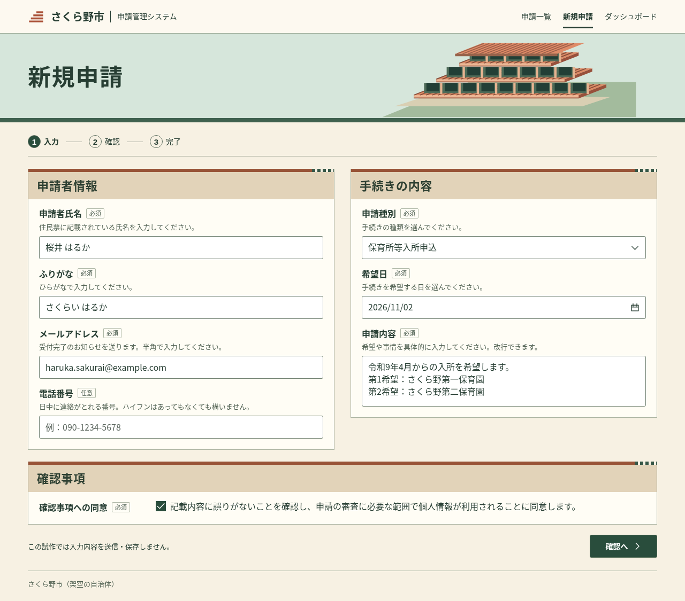
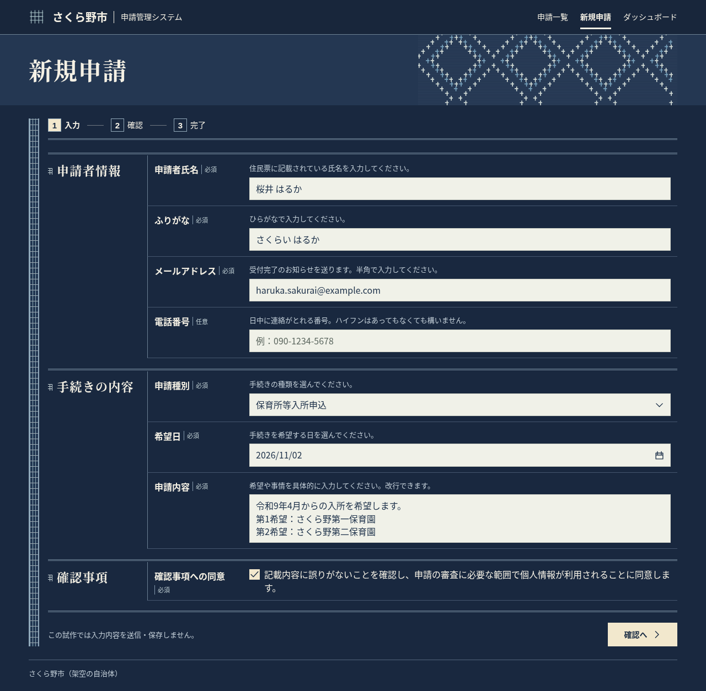

# 沖縄をテーマにした業務画面の再探索

最初に、下の2枚から何を連想するか、説明を読む前に見比べてほしい。次に「任意の電話番号を飛ばして確認へ進む」「処理待ち19件の一覧を探す」という同じ作業を目でたどる。地域の印象と、操作を見つけた位置を別々に記録する。

| 案A | 案B |
| --- | --- |
|  |  |

| 画面 | 現行「彩」・実装画像 | 案A | 案B |
| --- | --- | --- | --- |
| フォーム・1280px | [彩を開く](../ryukyu-modern-visuals/impl-sai-form-1280.png) | [Aを開く](terrace-form-1280.png) | [Bを開く](thread-form-1280.png) |
| フォーム・375px | [彩を開く](../ryukyu-modern-visuals/impl-sai-form-375.png) | [Aを開く](terrace-form-375.png) | [Bを開く](thread-form-375.png) |
| 集計・1280px | [彩を開く](../ryukyu-modern-visuals/impl-sai-dashboard-1280.png) | [Aを開く](terrace-dashboard-1280.png) | [Bを開く](thread-dashboard-1280.png) |
| 集計・375px | [彩を開く](../ryukyu-modern-visuals/impl-sai-dashboard-375.png) | [Aを開く](terrace-dashboard-375.png) | [Bを開く](thread-dashboard-375.png) |

**ヘッダーを隠すとどう見えるか。** 集計条件が同じ場面から、概況の見出しと4指標だけを原寸で抜き出した。71件の受付から19件の処理待ちへ、各案で視線がどう移るかを比べられる。[3案の本文比較](body-comparison.png)

## 現行「彩」で読み取れるもの

深緑の見出しの脇に、赤瓦色・黄金・藍の円弧や角形が並ぶ。3画面を切り替えても同じ帯が現れ、同じシステムだと認識する手掛かりになる。本文では、砂色の面が検索条件・手順・集計条件の置き場を示し、藍の罫が記録の始まりを示す。一方、本文だけの4指標は均等な区画として読める。染め分けや石積みという由来をそこから特定する手掛かりは乏しい。これは今回の画面観察と制作者の解釈で、地域の利用者による識別結果はまだない。[動く3画面](https://yantkys.github.io/design-lab/experiments/ryukyu-modern/)・[3画面の設計メモ](../ryukyu-modern-visuals/sai-three-screens.md)・[初期案](../ryukyu-modern-concept.md)

## 案Bの動く試作

案Bを[独立した3画面の試作](https://yantkys.github.io/design-lab/experiments/okinawa-thread/)にした（[ソース](../../site/experiments/okinawa-thread/)）。現行「彩」の[試作](https://yantkys.github.io/design-lab/experiments/ryukyu-modern/)は別ページのまま残している。一覧はモックがないため、番号と状態の列を先に読み、選んだ記録の直下に同じ項目軸で詳細を差し込む形に展開した。画面写真（上部の試作注記は非表示）：申請一覧 [1280px](impl-thread-list-1280.png)・[375px](impl-thread-list-375.png)、新規申請 [1280px](impl-thread-form-1280.png)・[375px](impl-thread-form-375.png)、ダッシュボード [1280px](impl-thread-dashboard-1280.png)・[375px](impl-thread-dashboard-375.png)。

## 案A　庇と通路（仮称）

**参照した事実。** 名護市は市庁舎の設計について、街側に重なるアサギテラス、ルーバーがつくる日陰、外廊下などを通る風の道を説明している。市民との対話の場をどう開くかという、沖縄本島北部の一つの公共建築に着目した。[名護市「名護市庁舎概要」](https://www.city.nago.okinawa.jp/about/2018072000468/)

**画面への翻訳。** 開口と水平な庇を、短い柱と平板による独自の略図にした。本文でも、土色の見出しがひと続きの庇になり、その下を一つの作業場所として読む。PCのフォームでは左に申請者、右に手続きの内容を置き、間に明るい通路を空ける。2か所を記入した先に全幅の同意欄を置く。集計では一つの庇の下に4つの数値を置き、月別と状態別を別の区画にする。375pxでは区画を積み、見出しと入力欄を近づける。粘土色・葉色・砂色は画面用の選色で、庁舎の測色値ではない。

**向く作業と弱点。** 住民が記入場所を見分ける場面を想定した。窓口や日陰を連想できても、画面だけで名護を特定できるかは未知。強い見出しが増えると全区画が同じ重要度に見える。PCで欄を行き来した際には、視線とTab順が一致するかを確かめたい。

## 案B　糸の交点（仮称）

**参照した事実。** 宮古織物事業協同組合は、宮古上布の経糸・緯糸に苧麻を用い、方眼に十字絣を割り付け、糸を締めて染める工程を紹介している。宮古島市は糸づくりから仕上げまでを専門の作り手が分担する技術と説明している。ここで参照したのは宮古の技法である。[宮古織物事業協同組合「作業工程」](https://www.miyako-joufu.com/work.html)・[宮古島市「宮古上布」](https://www.city.miyakojima.lg.jp/soshiki/kyouiku/syougaigakusyu/syougaikakusyu/bunkazai-MiyakoJofu.html)

**画面への翻訳。** 短い縦線・横線をずらして交差させ、新しく組んだ反復を見出し端と本文左の細い帯に置く。本文は濃藍の地に、縦の項目軸と横罫を通す。フォームは章・項目名・入力値の交点を拾う読み方にし、明るい無地の入力欄を各行に1つ置く。集計は同じ軸に指標名・値・定義を並べ、月を縦にたどる横棒にする。見出しの明朝と本文のゴシックで章と値を区別する。375pxでは項目名を値の直上に戻し、左の帯を細くする。

**向く作業と弱点。** 担当者が一つずつ値を照合する用途を想定した。染織を連想する余地がある一方、十字の反復が刺繍や一般的な格子にも見える。暗い地と明るい欄の反復は、長文入力では眩しさにつながり得る。実機で評価し、必要なら入力面の明度差を下げる。

2案の図は基本図形から描いた。建物の写真・実測図、工芸品の図案や型紙は使用していない。名護と宮古は異なる二つの出発点で、県全体を表す記号としての採否は求めない。

## 採用・実装を判断するための差

| 選択肢 | 一覧に展開したとき | 現行からの変更量と注意点 |
| --- | --- | --- |
| 現行「彩」を維持・改善 | 横索引・5列表・行直下の詳細を実装済み。フォーム・集計への移動も確認できる。 | 維持なら実装不要。操作性を優先して現行を採用し、名称だけ見直す選択もある。小改修なら、検索・手順・集計条件を置く帯を重点に試す。 |
| Aを試す | 検索を入口の区画、結果を広い台帳とし、詳細は同じ庇の内側で開く。行ごとに庇を付けると密度が落ちるため、区画単位で使う。 | 中程度。共通の検索・検証・集計を引き継ぎ、明色の面、フォームのグループ配置、見出しと画面上端を作り替える。 |
| Bを試す | 番号と状態の列を固定した読み順にし、選んだ記録の直下に、同じ項目軸で詳細を差し込む。 | 大きい。共通モデルを引き継ぎ、暗色面上の入力、リンク、通知、フォーカスを全状態で再設計する。グラフも月を読む向きが変わる。 |
| さらに探索 | 下線・件数・戻り先など既存の操作語彙を次の試作にも持ち込める。 | 地域の印象が図の説明に依存するなら、名称決定を保留し、実際に連想された場所や素材をもとに主題を選び直す。 |

**静止画で確認した範囲。** 2案は共通の正常な入力例を使い、現行画像と同じく任意の電話を空欄とした。集計は令和8年度・全担当課・基準日2026年10月12日。共通モデルから受付71件・待ち19件・完了52件・完了率73.2%を取得し、月別7か月、状態5区分、種別8種の各合計を照合した。1280px・375pxとも、ページ全体の幅が指定幅に収まることを確認した。主ボタンの文字と地の計算上のコントラスト比はAが9.45:1、Bが11.74:1。現在地は下線、主操作は動詞と塗り、絞り込み先は下線付きの名称で示す。エラーは「エラー」・修正理由・欄の太枠、フォーカスは選択から独立した外枠を次の試作で確認する。操作速度・読み上げ・地域の印象は未検証。[フォーム定義](../../site/assets/js/form.js)・[集計モデル](../../site/assets/js/dashboard.js)・[UI品質レビュー観点](../ui-quality-review.md)
