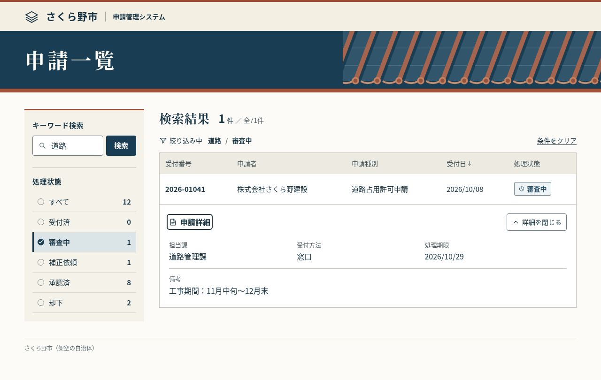
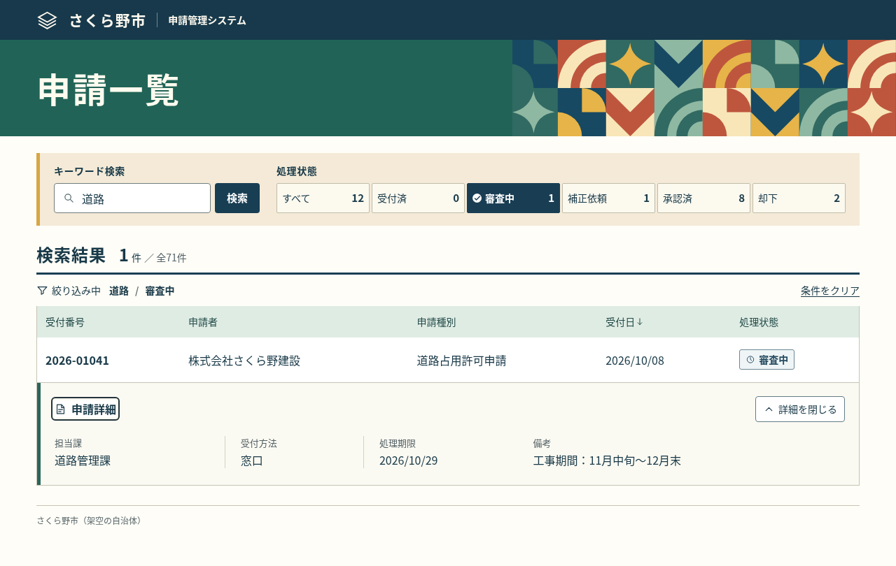
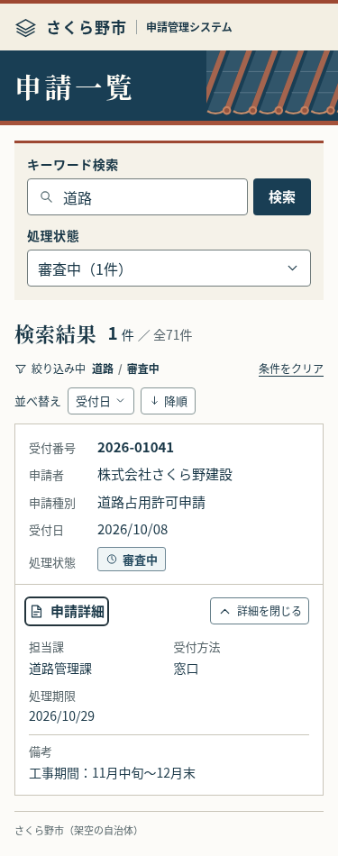
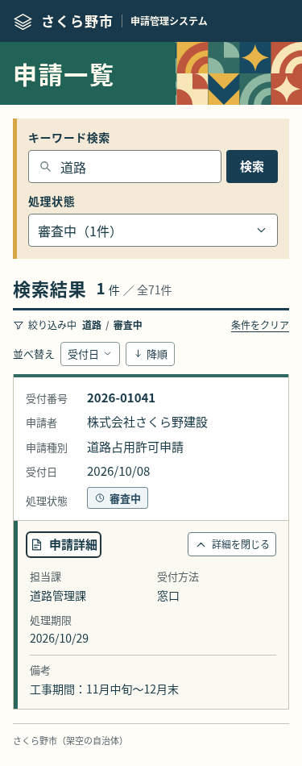

# 琉球モダンの申請一覧を「静」と「彩」で比べる

| A案・静 | B案・彩 |
| --- | --- |
|  |  |
| [静を原寸で開く（1280 × 810）](sei-1280.png) | [彩を原寸で開く（1280 × 810）](sai-1280.png) |
|  |  |
| [静を原寸で開く（375 × 950）](sei-375.png) | [彩を原寸で開く（375 × 950）](sai-375.png) |

4枚とも「道路」で検索し、「審査中」を選んで申請詳細を開いた直後。検索語に一致するのは12件、審査中は1件。受付番号2026-01041の同じ5項目と、担当課・受付方法・処理期限・備考を表示した。375pxでは両案とも状態をセレクトで選び、法人名と処理期限を一列の読み順で追える。横に並べた画像は縮小されるので、文字の判読は原寸で比べる。

## 現行の試作から変えたところ

現行の試作は白い台帳と石灰岩色の索引を太い境界で分け、検索結果の短い罫に赤瓦色を使っている。「色味が少なく、琉球モダンらしさが分からない」という利用者の感想を受け、今回はページを開いた時点で見える位置に地域表現を置いた。[現行の試作](https://yantkys.github.io/design-lab/experiments/ryukyu-modern/)・[最初の設計案](../ryukyu-modern-concept.md)

| 判断 | A案・静 | B案・彩 |
| --- | --- | --- |
| 地域の着想と造形 | 竹富島の赤瓦の屋根と石灰岩の石積みを手がかりに、瓦の列を斜線と小さな円弧に描き直した。軒の下を通る長い赤瓦色の罫が、見出しと作業面の境になる。 | 藍型を含む染め分けから、地の色を残して別の色の形を見せる考え方を借りた。円弧・三角・四方に開く形を自作し、藍・赤瓦・黄金・緑の面が隣り合う帯に組んだ。 |
| 面・文字・境界 | 藍地に白の明朝見出し、淡い石灰岩色にゴシックの索引、白地にゴシックの記録。検索欄を縦索引の先頭に移し、左右の面の切れ目で「選ぶ」と「読む」を分ける。 | 藍のシステム名、深緑に白の太いゴシック見出し、砂色の検索領域を横に重ねる。状態を検索欄と並ぶ6択にし、その下は全幅を記録に使う。多色の図形は見出しの右端で止める。 |
| 操作と意味色 | 検索は藍の塗り、選択中は淡い藍地・左の太線・チェック。反復作業では状態名と件数を縦に追える。一方、索引が長い法人名のための幅を使い、軒の意匠だけでは地域が伝わりにくい可能性がある。 | 検索は藍の塗り、選択中は濃い藍地・チェック・状態名。詳細を読む横幅が広がる一方、横索引は件数を縦に照合できず、見出しの模様が検索欄より先に目を引く可能性がある。 |

竹富島の集落景観と藍型は、地域と技法の具体例として参照した。斜線の角度、型の組合せ、色値、UIへの割当ては今回の創作で、素材はすべて基本図形から描いた。既存の写真・型紙・作品図案の転載はない。[竹富町教育委員会の景観解説](https://www.town.taketomi.lg.jp/soshiki/kyoikuiinkai/syakaibunka/1761628946/)・[沖縄県立図書館「基礎知識」](https://www.library.pref.okinawa.jp/archive/contents/cat38/knowledge.html)

## レビューで決めたいこと

1. **地域性を先に見る。** 上の画像だけを見て、どの形や面から何を連想したかを各案について記録する。第一候補の「彩」は、模様を置いた位置と面積まで含めて判断する。「静」も同じ問いで評価し、「静」「彩」「両案を再考」から選ぶ。
2. **業務上の読みやすさを別に見る。** 原寸で「選択中の状態」「申請者」「処理期限」「フォーカスのある位置」を順に指せるか。375pxで長い法人名と日付を読むとき、模様や罫が目をそらす箇所があれば場所を記録する。[UI品質レビュー観点](../ui-quality-review.md)
3. **色と状態を照合する。** 両案の「審査中」は時計と文言、開いた「申請詳細」のフォーカス例は見出しを囲む外枠、副操作は山形と「詳細を閉じる」。赤瓦色は画面の構造と装飾に使う。入力エラーには欄に接する太枠と「エラー」・修正方法、危険操作には対象と動詞を明示する方針とし、装飾の帯に通知の意味を持たせない。

不透明な指定色のsRGB計算値は、主操作の白文字／藍地が **11.30:1**、大見出しは静 **11.10:1**、彩 **6.71:1**、共通の状態バッジ文字／地が **8.44:1**。各幅で画像を書き出し、文字と意匠の重なり、表示領域内に1件とその詳細が収まることを確認した。地域性の伝わり方はレビューで判断する。キー操作、支援技術での挙動、業務時間は静止画では評価できない。
