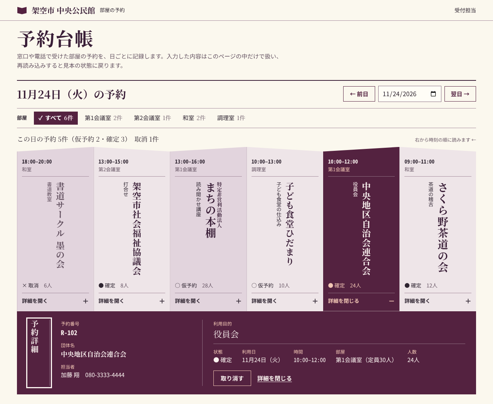

# 検証記録：h-prime-ui Skill を別の業務に適用する（PoC）

[Skill の導入方法に戻る](../../skills/README.md)

「折本」（H′）の Skill（[skills/h-prime-ui](../../skills/h-prime-ui/SKILL.md)）を、比較サイトにない別の業務（公民館の部屋の予約台帳）に当てはめて、Skill の規則で同じ系統の画面を組めるかを確かめた記録です。

## 結論を読む前の注意

- **Skill を書いた本人が、同じ作業の中でそのまま作った見本です。** 作り手は比較サイトの `h-prime` の実装を読んだ後なので、Skill の資料に書いていない知識が混ざっている可能性があります。
- **別のセッションで Skill だけを渡した評価はしていません（未検証）。** Skill の資料だけで同じ水準の画面を組めるか（移植の再現性）は分かっていません。
- Claude Code や Codex に Skill を導入して、Skill が自動で選ばれ・読まれるかは試していません。
- 判定は作り手自身によるもので、利用者による評価ではありません。

## 作り方

**参照した Skill のファイル**

- `SKILL.md`（手順・自己点検）
- `references/design-principles.md`（どの部品を使うかの判断表・守る規則・変えてよい点・避ける誤用）
- `references/patterns.md`（地と表題・右から左の面と詳細・見開きのフォーム・確認の帯とエラー・狭い幅）
- `assets/tokens.css`（[assets/](assets/) へそのままコピー。中身が Skill と同じことをユニットテストで確認）

**依頼文として想定したもの**

```text
公民館の部屋の予約を記録する小さな画面（1日分の予約の一覧・部屋の絞り込み・詳細・確定と取消・予約の入力）を、
h-prime-ui Skill を使って「折本」で作ってください。
素の HTML / CSS / JavaScript で、外部の CDN・フォント・API は使わず、file:// で開けるようにしてください。
1280px と 375px で崩れないことを確認してください。
```

**作ったもの**：[index.html](index.html)、[app.css](app.css)、[app.js](app.js)。比較サイト（`site/`）のファイルは読み込まず、`main.js`・`data-action` の規約・共通のモデル・URL の規約・見開きの番号の持ち方も使っていません。CSS は Skill の型から書き、`h-prime.css` の写しではありません。予約はページのメモリ上だけで扱い、保存・送信はしません。

新規作成のため、Skill の「対象を先に確認する」手順は「素の HTML、モジュールを使わない、保存しない、1日の予約は数件」という前提の確認に置き換えました。

## 当てはめた内容

| Skill の規則 | この画面での形 |
| --- | --- |
| どの部品を使うか | 1日の予約は数件なので**縦組みの面**。予約の入力は「利用の内容」と「申込者」の2つのまとまりなので**見開き**。集計は業務にないため**指標の面・グラフは作らず**、件数の文（「この日の予約 5件（仮予約 2・確定 3）　取消 1件」）だけ |
| 右から左の面 | その日の予約を開始時刻の順に、先頭（最も早い時刻）を右端に。DOM・Tab も同じ順。時刻と部屋は面の上に横組み、団体名（法人格は小さく別の行）と利用目的だけを縦組み |
| 変えてよい点：送り | 原本の「1見開き8面・← 次の8件」の送りは作らず、その日の予約を全部並べる（1日の件数が少ないため） |
| 時系列の向き | 日付の前後は「← 前日」「翌日 →」の左から右のまま。面だけを右から左に読み、「右から時刻の順に読みます ←」と文字で示す |
| 選んだ面と詳細 | 選んだ面は葡萄色に反転し、面の列の直後に葡萄色の帯で詳細（予約番号・団体名・担当者｜利用目的・状態・日時・部屋・人数）。開くと詳細の見出しへ、閉じると開閉ボタンへフォーカス |
| 見開き | 右頁「利用の内容」（利用日・部屋・利用時間・利用目的）→ 左頁「申込者」（団体名・担当者・電話・人数）。DOM・Tab・エラーの一覧の順も右頁→左頁。章名は頁の右端に縦組み |
| 確認の帯 | 「利用の決まりを申込者へ伝えた」の同意を葡萄色の帯に |
| 選択とフォーカス | 部屋の絞り込みは葡萄色の塗り＋✓＋太字。フォーカスは葡萄色の外枠と淡い外光、葡萄色の面・帯の上では生成りの外枠 |
| エラー | 「入力エラーが n 件あります」にフォーカス、項目名のボタンで欄へ。欄に「！エラー：理由と直し方」、左の赤い帯と太枠、`aria-invalid`・`aria-describedby`。部屋と時間の重複・定員超過も同じ形で示す |
| 状態 | 仮予約 ○／確定 ●／取消 × と文字 |
| 狭い幅（760px 未満） | 団体名・利用目的を横組みにし、面を上から積む。見開きは右頁を上に。主操作を全幅に |

## Skill の規則から変えた点・作る中で直したこと

- **狭い幅の詳細の位置**：最初は Skill の型どおり「面の列の直後」に詳細を置いたが、375px では6件の帯の後に開き、2件目を開くと詳細が4件分離れた。狭い幅のときだけ、詳細を選んだ帯の中（開閉ボタンの直後）に置くように変えた（`matchMedia` で置き場所を切り替え、描き直す前に列の外へ戻す。幅が変わっても詳細の見出しのフォーカスを保つ）。この判断は Skill の `patterns.md` にも追記した。
- **中間の幅（900px）**：面が4面＋2面の2段になり、詳細は2段目の下に開く。上の段で選んだ面とのつながりは弱い（変えていない。Skill に注意として追記した）。
- **原本から変えた色**：補助文字（`--hp-muted`）と入力欄の枠（`--hp-control-line`）は、原本の値では右頁の地で基準を下回るため、Skill のトークンで濃くしたもの（[design-principles.md](../../skills/h-prime-ui/references/design-principles.md#原本から変えた値)）をそのまま使った。
- **フォームの中のボタンの id**：「入力を消す」のボタンに `id="reset"` を付けたところ、`form.reset` がボタンを指して `form.reset()` が失敗し、登録後に入力欄が消えなかった。id を `clear-form` に変えた（折本とは無関係の実装上の注意）。

## 確認した結果

Chromium（Playwright、ヘッドレス）で `file://` から開いて確認しました。

| 項目 | 結果 |
| --- | --- |
| 外部への通信・コンソールのエラー | なし（`file:` 以外の要求 0 件、エラー 0 件。1280px・375px） |
| ページ全体の横はみ出し | 1280px・900px・375px とも 0px（操作の前後） |
| 面の並び | 1280px：DOM の先頭（09:00）が右端（x=1037）で左へ。900px：4面＋2面の2段で、上の段の右端が先頭。375px：上から積む |
| Tab の順 | 部屋の選択 → 09:00 → 10:00（第1会議室）→ 10:00（調理室）→ 13:00 …（見た目の右から左と同じ） |
| 縦組みの切り替え | 団体名の `writing-mode` は 1280px で `vertical-rl`、375px で `horizontal-tb` |
| 詳細の開閉 | `aria-expanded` が切り替わり、開くと詳細の見出し、閉じると開閉ボタンへフォーカス。詳細は 1280px で列の直後、375px で選んだ帯の中。開いたまま幅を 1280px ↔ 375px に変えても、置き場所が切り替わりフォーカスが残る |
| 部屋の絞り込み | 「第1会議室」で2件 |
| 日の切り替え | 翌日（11月25日）で2件、その翌日は「この日の予約はありません」と入力への案内 |
| 確定・取消 | 「確定にする」で仮予約 ○ → 確定 ●。通知の文が読み上げ領域に入り、フォーカスは詳細の見出し |
| 見開き | 1280px：右頁 x=640、左頁 x=44。375px：右頁が上（y=1088）、左頁が下（y=1606）。利用目的の次の Tab は団体名 |
| 入力検証 | 空で登録 → 「入力エラーが8件あります」にフォーカス（画面内）、「団体名」で欄へ移り `aria-invalid="true"`、`aria-describedby` の先頭にエラー文 |
| 重複・定員 | 第1会議室 10:00–11:00・40人 → 「第1会議室は 10:00–12:00 に『中央地区自治会連合会』の予約があります」「第1会議室の定員は30人です」 |
| 登録 | 16:00–18:00・人数「２０」（全角）で登録 → 仮予約 R-109 が時刻の順の位置に入り、そのボタンへフォーカス、通知、入力欄が空に戻る |
| 葡萄色の帯の上のフォーカス | 同意のチェックボックスの外枠が生成り（`rgb(251, 243, 240)`） |
| 色（計算値） | 右頁の補助文字 `rgb(101, 83, 98)`（右頁の地で 4.95:1）、入力欄の枠 `rgb(134, 108, 130)`（右頁の地で 3.28:1） |

画面写真（ヘッドレスの Chromium のため、日付の欄が英語の書式で表示されています）：

| | 1280px | 375px |
| --- | --- | --- |
| 一覧（R-102 の詳細を開いた状態） | [booking-1280-list.png](screenshots/booking-1280-list.png) | [booking-375-list.png](screenshots/booking-375-list.png) |
| 入力エラー | [booking-1280-form-error.png](screenshots/booking-1280-form-error.png) | [booking-375-form-error.png](screenshots/booking-375-form-error.png) |



## 判定

| 観点 | 判定 | 理由 |
| --- | --- | --- |
| ① 折本だと分かるか | 分かる | 生成りの地、右から左に並ぶ傾いた面と縦組みの明朝の名前、選んだ面から続く葡萄色の詳細、右頁→左頁の見開きと縦組みの章名、葡萄色の確認の帯がそろう（作り手の見立て） |
| ② 元の画面の焼き直しでなく、新しい業務に合っているか | おおむね合っている | 申請の列・8面の送り・指標を持ち込まず、「時刻→部屋→団体名→目的」の面と「利用の内容→申込者」の見開きに組み直した。ただし作り手が元の実装を知っているため、Skill の資料だけでここまで組めるかは未確認 |
| ③ 主要操作が動くか | 動く | 日の切り替え・部屋の絞り込み・詳細・確定・取消・入力検証（重複・定員を含む）・登録を上の手順で確認 |
| ④ 1280px と 375px で破綻しないか | 破綻しない | どちらも横はみ出しなし。375px は横組みの帯と、選んだ帯の中の詳細、右頁が上の見開き |

## 未確認のこと

- **別のセッション（Claude Code・Codex など）に Skill だけを渡したときの再現性。**
- Claude Code・Codex での Skill の自動選択と読み込み。
- スクリーンリーダーでの縦組みの名前・面の並びの読み上げ、実機の IME での入力（この画面は入力中に絞り込みなどをしないため、変換中の挙動は既定のまま）、Chromium 以外のブラウザ、Windows の書体（BIZ UD 明朝・游明朝）での見え方。
- 1日の予約が十数件を超える日の見やすさ（面が多段に折り返す）。
- 長い団体名（20字以上）が続くときの縦組みの読みやすさ。
