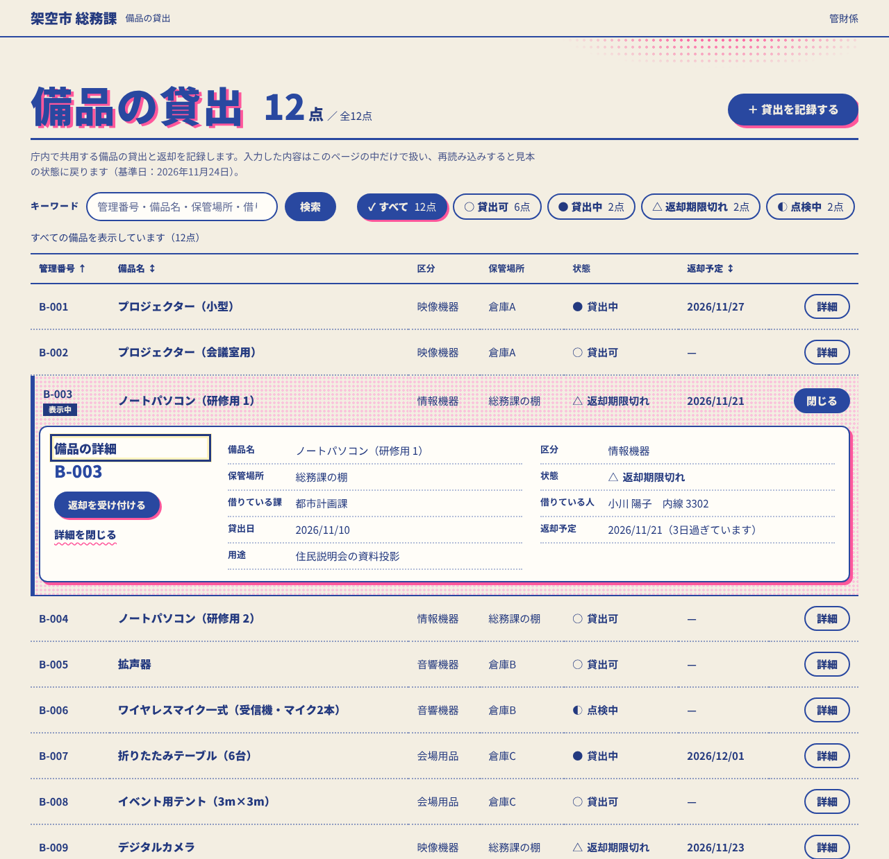

# 検証記録：j-risograph-ui Skill を別の業務に適用する（PoC）

[Skill の導入方法に戻る](../../skills/README.md)

「二色刷り」（J案）の Skill（[skills/j-risograph-ui](../../skills/j-risograph-ui/SKILL.md)）を、比較サイトにない別の業務（庁内で共用する備品の貸出台帳）に当てはめて、Skill の規則で同じ系統の画面を組めるかを確かめた記録です。

## 結論を読む前の注意

- **Skill を書いた本人が、同じ作業の中でそのまま作った見本です。** 作り手は比較サイトの `j-risograph` の実装を読んだ後なので、Skill の資料に書いていない知識が混ざっている可能性があります。
- **別のセッションで Skill だけを渡した評価はしていません（未検証）。** Skill の資料だけで同じ水準の画面を組めるか（移植の再現性）は分かっていません。
- Claude Code や Codex に Skill を導入して、Skill が自動で選ばれ・読まれるかは試していません。
- 判定は作り手自身によるもので、利用者による評価ではありません。

## 作り方

**参照した Skill のファイル**

- `SKILL.md`（手順・自己点検）
- `references/design-principles.md`（どの部品を使うかの判断表・守る規則・変えてよい点・避ける誤用）
- `references/patterns.md`（大見出しと網点の帯・検索と状態の札・点線罫の表と直後の詳細・章の入力欄・操作とエラー・狭い幅）
- `assets/tokens.css`（[assets/](assets/) へそのままコピー。中身が Skill と同じことをユニットテストで確認）

**依頼文として想定したもの**

```text
庁内で共用する備品の貸出と返却を記録する小さな画面（一覧・検索・状態の絞り込み・並べ替え・詳細・返却・貸出の記録）を、
j-risograph-ui Skill を使って「二色刷り」で作ってください。
素の HTML / CSS / JavaScript で、外部の CDN・フォント・API は使わず、file:// で開けるようにしてください。
1280px と 375px で崩れないことを確認してください。
```

**作ったもの**：[index.html](index.html)、[app.css](app.css)、[app.js](app.js)。比較サイト（`site/`）のファイルは読み込まず、`main.js`・`data-action` の規約・共通のモデル・URL の規約も使っていません。CSS は Skill の型から書き、`j-risograph.css` の写しではありません。備品と貸出はページのメモリ上だけで扱い、保存・送信はしません（基準日は 2026年11月24日に固定）。

## 当てはめた内容

| Skill の規則 | この画面での形 |
| --- | --- |
| どの部品を使うか | 備品は12点で列を比べるので**点線罫の表**、貸出の記録は**章の入力欄**（借りる備品／借りる人／確認事項）。集計は業務にないため、**指標の帯・棒グラフは作らず**、件数は大見出しの横と状態の札の文字だけ |
| 2つの版 | 文字・罫・操作・状態・エラーは青の版。ピンクは大見出しの版ずれ（`text-shadow`）、表題の上の網点の帯、選んだ行の淡い網点、章名の網点の下線、確認事項の網点の地、主操作と選んだ札のずれた影、リンクの波線の下線、「必須」の地だけ |
| 状態 | 貸出可 ○／貸出中 ●／返却期限切れ △／点検中 ◐ と文字。「返却期限切れ」は保存した値ではなく、基準日と返却予定日から決める |
| 選択 | 状態の札は青の塗り＋✓＋ずれた影。選んだ行は淡い網点＋左の青い帯＋「表示中」の札、詳細はその行の直後（紙の色の箱・青の枠・ピンクの影） |
| 詳細の操作 | 状態に合わせて「返却を受け付ける」「この備品の貸出を記録する」「点検を終える」のどれか1つと「詳細を閉じる」 |
| 並べ替え | 管理番号・備品名・返却予定の列見出しのボタンだけ（`aria-sort`）。返却予定のないものは向きによらず最後。狭い幅では列見出しが「並べ替え」の札の列になり、操作は1組だけ |
| エラー | 二重罫の枠のエラーの一覧（反転札「エラー」＋件数）にフォーカス、項目名のボタンで欄へ。欄には反転札「エラー」と理由・直し方、二重罫の太枠、`aria-invalid`・`aria-describedby`。ピンクは使わない |
| 中間の幅（1099px 以下） | 保管場所の列を隠し（詳細で読む）、区分を折り返さない。狭い幅の縦に積んだ行では、保管場所もラベル付きで見せる |
| 狭い幅（760px 未満） | 大見出し 38px、網点の帯を低く・狭く、主操作は全幅。表は行ごとに縦へ積み、値に「区分」「保管場所」「返却予定」のラベル。章は1列 |
| 強制カラー | 網点・ずれた影・左の青い帯（`box-shadow`）が消えるため、選んだ行に `Highlight` の枠と左の帯、反転札に枠、選んだ札の枠を太く（この判断は Skill の `patterns.md` にも追記した） |

## Skill の規則から変えた点・作る中で直したこと

- **中間の幅の列**：900px で7列のままだと「区分」が1文字ずつ折り返したため、1099px 以下で保管場所の列を隠し、区分を折り返さないようにした（業務に合わせた判断。保管場所は詳細と狭い幅の行で読める）。
- **強制カラーの選んだ行**：Chromium の強制カラーのエミュレーションで、選んだ行の網点と左の帯が消え、「表示中」の札だけが残ることを確かめた。枠で補う規則を足した（上の表）。
- **フォーム部品の取り出し方**：最初は `form.elements[name]` で欄を取り出していたが、`name="item"` の欄は `form.elements.item`（コレクションの `item()` メソッド）と衝突し、備品の選択肢を作れず一覧も描けなかった。id で取り出すように直した（二色刷りとは無関係の実装上の注意。折本の見本の `form.reset` と同じ種類の衝突）。
- **描き直しとフォーカス**（折本の [PR #83](https://github.com/YanTKYS/design-lab/pull/83) の教訓）：状態の札（ラジオ）は最初に1回だけ作り、描き直しでは `checked` と件数だけを更新した。列見出しの並べ替えは表ごと描き直すため、押した見出しのボタンへフォーカスを戻した。どちらも E2E（[tests/e2e/skill-examples.spec.mjs](../../tests/e2e/skill-examples.spec.mjs)）で確認し、それぞれの処理を外すとテストが失敗することも確かめた。

## 確認した結果

Chromium（Playwright、ヘッドレス）で `file://` から開いて確認しました。

| 項目 | 結果 |
| --- | --- |
| 外部への通信・コンソールのエラーと警告 | なし（`file:` 以外の要求 0 件。1280px・900px・375px） |
| ページ全体の横はみ出し | 1280px・900px・375px とも 0px（操作の前後） |
| 網点の帯と大見出し | 網点の下端（1280px で y=98）が大見出しの上端（y=118）より上。網点は大見出し・件数・「＋ 貸出を記録する」と重ならない（3つの幅） |
| 状態の札 | キーボード：「すべて」から → で貸出可（6点）、もう一度 → で貸出中（2点）、→ で返却期限切れ（2点、「絞り込み中」の条件の文）。選んだ札にフォーカスが残る |
| 並べ替え | 「返却予定」で B-003（11/21）→ B-009 → B-001 → B-007 → 返却予定のないもの。もう一度で逆順（返却予定のないものは最後のまま）。押したボタンにフォーカスが残り、`aria-sort` が切り替わる。375px でも並べ替えの操作は3つ（1組）だけ |
| 検索と IME | 変換中（「そうこ」）は12点のまま絞り込まず、確定（「倉庫A」）で3点。「条件をクリア」で12点に戻り、検索欄へフォーカス |
| 詳細 | 「詳細」で選んだ行の直後に開き、「表示中」の札、詳細の見出しへフォーカス。返却期限切れは「3日過ぎています」。閉じると「詳細」のボタンへフォーカス |
| 返却 | 返却期限切れで絞り込んだまま B-009 の返却を受け付けると、貸出可になり、絞り込みを解除して行を残し、通知の文が読み上げ領域に入る。フォーカスは詳細の見出し |
| 貸出の記録 | 詳細の「この備品の貸出を記録する」で備品の欄に B-009 が入り、その欄へフォーカス。空で記録 → 「入力エラーが7件あります」にフォーカス、「内線番号」で欄へ移り `aria-invalid="true"`、`aria-describedby` の先頭にエラー文。返却予定日を26日後にすると「14日以内」のエラー。12月4日・内線「２３０１」（全角）で記録 → B-002 が貸出中になり、その行の「詳細」へフォーカス、通知、貸出できる備品の選択肢が減る |
| エラー時の同意欄のフォーカス | 外枠が濃い青（`rgb(35, 57, 127)`）の実線 |
| 強制カラー（明るい配色。Chromium のエミュレーション） | 選んだ行に枠と左の帯、「表示中」の札に枠。状態の記号と文字は残る。空で記録したとき、エラーの一覧は二重罫 4px、欄は二重罫 3px、反転札「エラー」は枠付き（計算値） |

画面写真（ヘッドレスの Chromium のため、日付の欄が英語の書式で表示されています）：

| | 1280px | 375px |
| --- | --- | --- |
| 一覧（B-003 の詳細を開いた状態） | [lending-1280-list.png](screenshots/lending-1280-list.png) | [lending-375-list.png](screenshots/lending-375-list.png) |
| 入力エラー | [lending-1280-form-error.png](screenshots/lending-1280-form-error.png) | [lending-375-form-error.png](screenshots/lending-375-form-error.png) |
| 強制カラー（1280px） | [lending-forced.png](screenshots/lending-forced.png) | — |



## 判定

| 観点 | 判定 | 理由 |
| --- | --- | --- |
| ① 二色刷りだと分かるか | 分かる | 生成りの紙に青の版、大見出しのピンクの版ずれ、右上の網点の帯、点線罫の表、網点の地と青い帯と「表示中」の札の選んだ行、ずれた影の主操作、反転札と二重罫のエラーがそろう（作り手の見立て） |
| ② 元の画面の焼き直しでなく、新しい業務に合っているか | おおむね合っている | 申請の列・指標・月別の棒を持ち込まず、「管理番号→備品名→区分→保管場所→状態→返却予定」の表と、返却・点検の操作、14日以内の返却予定の検証に組み直した。ただし作り手が元の実装を知っているため、Skill の資料だけでここまで組めるかは未確認 |
| ③ 主要操作が動くか | 動く | 検索・状態の絞り込み・並べ替え・詳細・返却・貸出の記録と入力検証を上の手順で確認 |
| ④ 1280px と 375px で読めるか | 読める | どちらも横はみ出しなし。網点・版ずれ・件数・操作が重ならない。375px は行ごとに縦に積み、並べ替えの札は1組 |

## 未確認のこと

- **別のセッション（Claude Code・Codex など）に Skill だけを渡したときの再現性。**
- Claude Code・Codex での Skill の自動選択と読み込み。
- スクリーンリーダーでの縦に積んだ表の読み上げ、実機の IME（ヘッドレスの Chromium で変換中のイベントを送って確認しただけ）、Chromium 以外のブラウザ、実際の OS の強制カラー・ハイコントラスト、色覚の違いによる見え方、印刷。
- 長時間使ったときに、蛍光ピンクの飾りが落ち着かないか。
- 備品が数十点を超えるときの見やすさ（ページ送りや絞り込みの工夫は作っていない）。
