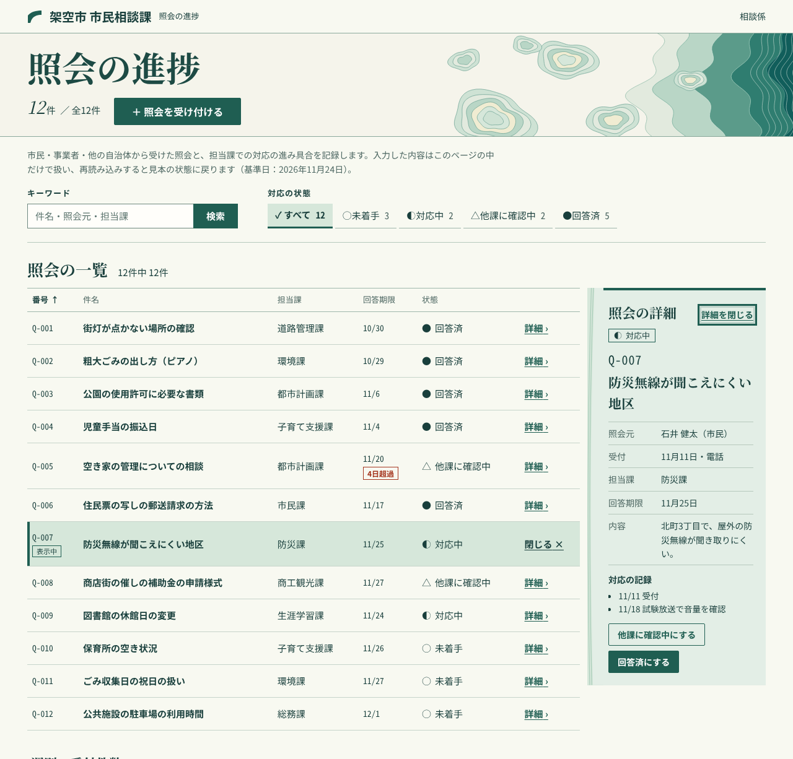

# 検証記録：k-shoreline-ui Skill を別の業務に適用する（PoC）

[Skill の導入方法に戻る](../../skills/README.md)

「汀線」（K案）の Skill（[skills/k-shoreline-ui](../../skills/k-shoreline-ui/SKILL.md)）を、比較サイトにない別の業務（市民相談課で受けた照会の進捗管理）に当てはめて、Skill の規則で同じ系統の画面を組めるかを確かめた記録です。

## 結論を読む前の注意

- **Skill を書いた本人が、同じ作業の中でそのまま作った見本です。** 作り手は比較サイトの `k-shoreline` の実装を読んだ後なので、Skill の資料に書いていない知識が混ざっている可能性があります。
- **別のセッションで Skill だけを渡した評価はしていません（未検証）。** Skill の資料だけで同じ水準の画面を組めるか（移植の再現性）は分かっていません。
- Claude Code や Codex に Skill を導入して、Skill が自動で選ばれ・読まれるかは試していません。
- 判定は作り手自身によるもので、利用者による評価ではありません。

## 作り方

**参照した Skill のファイル**

- `SKILL.md`（手順・自己点検）
- `references/design-principles.md`（デザインの核・部品の判断表・守る規則・変えてよい点・避ける誤用）
- `references/patterns.md`（表題の装飾・絞り込みの札・表と選んだ行と右の列の詳細・章の陸と水際・エラー・推移の曲線・狭い幅・強制カラー）
- `assets/tokens.css`、`assets/k-shore.svg`（[assets/](assets/) へそのままコピー。中身が Skill と同じことをユニットテストで確認）

**依頼文として想定したもの**

```text
市民相談課で受けた照会の進捗を管理する小さな画面（一覧・検索・状態の絞り込み・並べ替え・詳細・状態の変更・週別の受付件数・照会の受付）を、
k-shoreline-ui Skill を使って「汀線」で作ってください。
素の HTML / CSS / JavaScript で、外部の CDN・フォント・API は使わず、file:// で開けるようにしてください。
1280px と 375px で崩れないことを確認してください。
```

**作ったもの**：[index.html](index.html)、[app.css](app.css)、[app.js](app.js)。比較サイト（`site/`）のファイルは読み込まず、`main.js`・`data-action` の規約・共通のモデル・URL の規約も使っていません。CSS は Skill の型から書き、`k-shoreline.css` の写しではありません。表題の等高線だけは Skill に同梱した `k-shore.svg`（原本と同じ自作の図形）を使っています。照会はページのメモリ上だけで扱い、保存・送信はしません（基準日は 2026年11月24日に固定）。

## 当てはめた内容

| Skill の規則 | この画面での形 |
| --- | --- |
| どの部品を使うか | 照会は1件ずつ選んで経緯を読むので、**選んだ行と続く詳細**（広い幅では右の列）。受付は2つのまとまり（照会の内容／照会元と担当）なので**章の陸と水際**。照会の受付件数は週ごとに見る集計なので、**週別の推移**を使った。指標の帯は業務にないため作らず、件数は表題の横と札の文字だけ |
| 選んだ行と詳細 | 選んだ行は陸の面＋左の濃い緑の線＋「表示中」＋「閉じる ×」（`aria-expanded`）。詳細は DOM・Tab の順で行の直後。1000px 以上では右の列（300px）に見せ、開く前から「一覧の『詳細』を選ぶと、ここに表示します」で列を確保。詳細の左端に汀線、上端に濃い緑の線、見出しの横に「詳細を閉じる」、経緯（対応の記録）と状態を進めるボタン |
| 行の直下の詳細（999px 以下） | 選んだ行の陸の面と左の線が、詳細の行まで続く（この判断は Skill の `patterns.md` にも追記した）。375px では汀線を省き、詳細の左下の角を丸める |
| 章の陸と水際 | 左に章名の陸、右に入力欄の水際、間に汀線（SVG、章の高さに合わせて伸びる）。エラーがあると章名の下に「この章に n 件のエラー」 |
| 推移の曲線 | 週ごとの受付件数（6週）。点・縦の線・件数が実測、点線の曲線と面は目安（単調3次補間）。0件の週（11月2日の週）は基準線。図の下に「点が各週の受付件数です。線と面は推移の目安で…」 |
| 状態 | 未着手 ○／対応中 ◐／他課に確認中 △／回答済 ●と文字。回答期限の超過は「4日超過」の文字の札と、詳細の「4日過ぎています」 |
| 並べ替え | 番号・回答期限の列見出しのボタンだけ（`aria-sort`）。375px では「並べ替え」の札の列に2つだけ |
| 強制カラー | 選んだ行・詳細の行に `Highlight` の枠、選んだ札に枠、詳細の箱に枠、推移の実測の点は `CanvasText` で残す |

## Skill の規則から変えた点・作る中で直したこと

- **中間の幅の詳細の行**：最初は原本と同じく、999px 以下で詳細の行の地を生成りのままにしていたが、選んだ行の陸の面が詳細で途切れ、つながりが弱かった。詳細の行にも陸の面と左の線を続けた（Skill の型にも反映）。
- **右の列の詳細の高さ**：右の列の詳細は列の上端（画面の上）に留まる。下の方の行を選ぶと、行と詳細の高さがずれる（どちらも画面に見える位置にはある）。原本と同じ動きで、変えていない。
- **描き直しとフォーカス**（[PR #83](https://github.com/YanTKYS/design-lab/pull/83)・[PR #85](https://github.com/YanTKYS/design-lab/pull/85) の教訓）：状態の札（ラジオ）は最初に1回だけ作り、描き直しでは `checked` と件数だけを更新した。並べ替えの後は、描き直した表の押した見出しのボタンへフォーカスを戻した。欄は `form.elements[name]` ではなく id で取り出した。
- **並べ替えできない列の見出し**（PR #85 の指摘）：狭い幅では `th:not([aria-sort])` を隠し、並べ替えの札を1組にした。

## 確認した結果

Chromium（Playwright、ヘッドレス）で `file://` から開いて確認しました。

| 項目 | 結果 |
| --- | --- |
| 外部への通信・コンソールのエラーと警告 | なし（`file:` 以外の要求 0 件。1280px・1000px・900px・375px） |
| ページ全体の横はみ出し | 4つの幅とも 0px（操作の前後） |
| 詳細を開く前後の表の幅 | 1280px：892px → 892px、1000px：644px → 644px（右の列を先に確保しているため変わらない）、900px・375px：変わらない |
| 詳細の位置 | 1280px・1000px：表の右（表の右端の 12px 右）。900px：選んだ行の直下（行の下端と詳細の上端が 1px 差）。375px：選んだ行の直下。どの幅でも DOM の次の行が詳細の行で、詳細の見出しの次の Tab は「詳細を閉じる」 |
| 詳細の開閉とフォーカス | 開くと詳細の見出しへ、閉じると「詳細」のボタンへ |
| 状態の札 | キーボード：「すべて」から → で未着手（3件）、→ で対応中（2件）。選んだ札にフォーカスが残る |
| 並べ替え | 「回答期限」で Q-002（10/29）→ Q-001 → Q-004。もう一度で逆順（Q-012 が先頭）。押したボタンにフォーカスが残る。375px で見える並べ替えの操作は2つ（1組） |
| 検索と IME | 変換中（「かんきょう」）は12件のまま、確定（「環境課」）で2件 |
| 状態の変更 | 未着手で絞り込んだまま Q-010 の「対応を始める」→ 対応中になり、絞り込みを解除して行を残す。対応の記録に「11/24 対応中にした」、通知の文、フォーカスは詳細の見出し |
| 週別の推移 | 6週の件数 2・3・0・3・3・1。0件の週の縦の線の高さは 0px（基準線）、最多の3件は 109px（140px の 78%） |
| 照会の受付 | 空で受付 → 「入力エラーが7件あります」にフォーカス、章名の下に「この章に3件のエラー」「この章に4件のエラー」。「回答期限」で欄へ移り `aria-invalid="true"`、`aria-describedby` の先頭にエラー文。47日後の期限で「30日以内」のエラー。12月1日で受付 → Q-013 が一覧に入り、その行の「詳細」へフォーカス、通知、今週の受付件数が 1 → 2 |
| 章の汀線 | 1280px で章名の右端（240px）が陸の右端（300px）より左、入力欄は 300px から。汀線の高さは章の高さ（エラー文で伸びた 350px）と同じ。375px では汀線を隠す |
| 強制カラー（明るい配色。Chromium のエミュレーション） | 選んだ行の左に 6px・上下に 2px の `Highlight` の枠、選んだ札に枠、推移の点は黒で残る |

画面写真（ヘッドレスの Chromium のため、日付の欄が英語の書式で表示されています）：

| | 1280px | 375px |
| --- | --- | --- |
| 一覧（Q-007 の詳細を開いた状態） | [inquiry-1280-list.png](screenshots/inquiry-1280-list.png) | [inquiry-375-list.png](screenshots/inquiry-375-list.png) |
| 入力エラー | [inquiry-1280-form-error.png](screenshots/inquiry-1280-form-error.png) | [inquiry-375-form-error.png](screenshots/inquiry-375-form-error.png) |
| 中間の幅（900px、行の直下の詳細） | [inquiry-900.png](screenshots/inquiry-900.png) | — |
| 強制カラー（1280px） | [inquiry-forced.png](screenshots/inquiry-forced.png) | — |



## 判定

| 観点 | 判定 | 理由 |
| --- | --- | --- |
| ① 汀線だと分かるか | 分かる | 明朝の表題と等高線、選んだ行の陸の面から右の詳細の海へ続く面と左端の汀線、章名の陸と入力欄の水際を分ける曲線、実測の点と目安の曲線の推移がそろう（作り手の見立て） |
| ② 元の画面の焼き直しでなく、新しい業務に合っているか | おおむね合っている | 申請の列・指標・月別を持ち込まず、「番号→件名→担当課→回答期限（超過）→状態」の表、対応の記録と状態を進める操作、週別の受付件数、30日以内の回答期限の検証に組み直した。ただし作り手が元の実装を知っているため、Skill の資料だけでここまで組めるかは未確認 |
| ③ 主要操作が動くか | 動く | 検索・状態の絞り込み・並べ替え・詳細・状態の変更・照会の受付と入力検証を上の手順で確認 |
| ④ 1280px と 375px で読めるか | 読める | どちらも横はみ出しなし。1280px は表の右に詳細、375px は行の直下に詳細。汀線・等高線は文字・入力欄・操作に重ならない |

## 未確認のこと

- **別のセッション（Claude Code・Codex など）に Skill だけを渡したときの再現性。**
- Claude Code・Codex での Skill の自動選択と読み込み。
- スクリーンリーダーでの、右の列に見せた詳細・縦に積んだ表・推移の図の読み上げ。実機の IME（ヘッドレスの Chromium で変換中のイベントを送って確認しただけ）、Chromium 以外のブラウザ、実際の OS の強制カラー、色覚の違いによる淡い緑の面の見分けやすさ。
- 照会が数十件を超えるとき（右の列の詳細と下の方の行が離れる）の使いやすさ。
