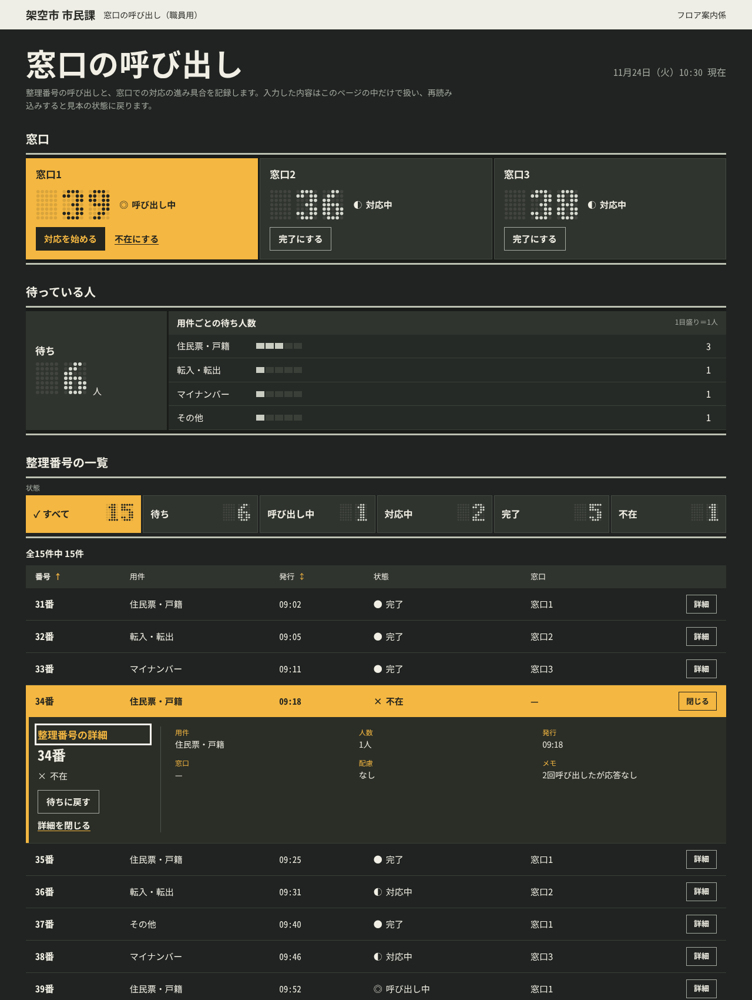

# 検証記録：l-signage-ui Skill を別の業務に適用する（PoC）

[Skill の配布・導入方法（design-skills）](https://github.com/YanTKYS/design-skills#導入する)

「標示盤」（L案）の Skill（[l-signage-ui](https://github.com/YanTKYS/design-skills/tree/main/skills/l-signage-ui)）を、比較サイトにない別の業務（市民課の窓口の呼び出しと整理番号の管理、職員用）に当てはめて、Skill の規則で同じ系統の画面を組めるかを確かめた記録です。

> Skill の正本は [YanTKYS/design-skills](https://github.com/YanTKYS/design-skills/tree/main/skills/l-signage-ui) に移りました。この見本は、Skill を design-lab で作った当時に作った**固定の見本**です。`assets/` は当時のコピーで、design-skills の最新版とは同期しません（design-lab での最後の版：[skills/l-signage-ui](https://github.com/YanTKYS/design-lab/tree/0dfc2b7/skills/l-signage-ui)）。

## 結論を読む前の注意

- **Skill を書いた本人が、同じ作業の中でそのまま作った見本です。** 作り手は比較サイトの `l-signage` の実装を読んだ後なので、Skill の資料に書いていない知識が混ざっている可能性があります。
- **別のセッションで Skill だけを渡した評価はしていません（未検証）。** Skill の資料だけで同じ水準の画面を組めるか（移植の再現性）は分かっていません。
- Claude Code や Codex に Skill を導入して、Skill が自動で選ばれ・読まれるかは試していません。
- 判定は作り手自身によるもので、利用者による評価ではありません。

## 作り方

**参照した Skill のファイル**

- `SKILL.md`（手順・自己点検）
- `references/design-principles.md`（デザインの核・部品の判断表・守る規則・変えてよい点・避ける誤用・未検証の条件）
- `references/patterns.md`（盤面と区画・ドット文字・状態の盤面・台帳と詳細・手順のフォーム・エラー・1目盛り＝1件・狭い幅・強制カラー）
- `assets/tokens.css`、`assets/dot-digits.js`（[assets/](assets/) へそのままコピー。当時は中身が Skill と同じことをユニットテストで確認していた。`dot-digits.js` の字形が比較サイトの標示盤と同じことも、ユニットテストで確認）

**依頼文として想定したもの**

```text
市民課の窓口の呼び出しを管理する職員用の小さな画面（窓口ごとの呼び出し・対応・完了、待っている人数、整理番号の一覧と詳細、整理番号の発行）を、
l-signage-ui Skill を使って「標示盤」で作ってください。
素の HTML / CSS / JavaScript で、外部の CDN・フォント・API は使わず、file:// で開けるようにしてください。
1280px と 375px で崩れないことを確認してください。
```

**作ったもの**：[index.html](index.html)、[app.css](app.css)、[app.js](app.js)。比較サイト（`site/`）のファイルは読み込まず、`main.js`・`data-action` の規約・共通のモデル・URL の規約も使っていません。CSS は Skill の型から書き、`l-signage.css` の写しではありません。整理番号はページのメモリ上だけで扱い、保存・送信はしません（時刻は 11月24日 10:30 に固定）。

## 当てはめた内容

| Skill の規則 | この画面での形 |
| --- | --- |
| どの部品を使うか | 窓口の呼び出しは「今どの番号を呼んでいるか」を一目で見せる業務なので、**窓口ごとの区画**（番号をドット文字）と**状態の盤面**。整理番号は1件ずつ経緯を見るので**台帳と詳細**。発行は用件と配慮の2つの章を確かめてから出すので**手順のフォーム**（入力 → 確認）。用件ごとの待ち人数は窓口の配置を決める集計なので**1目盛り＝1人**。推移のグラフや指標の帯は業務にないため作らなかった |
| 琥珀は現在地だけ | 呼び出し中の窓口の区画、選んだ状態の区画、選んだ行と詳細の左の帯、フォームの現在の手順と罫、主操作（次を呼ぶ・確認へ・発行する）。対応中・空きの窓口は暗い区画のまま |
| ドット文字 | 窓口の番号（3桁にそろえ、左は消灯の桁）、待ち人数（2桁）、状態の盤面の件数（2桁）、手順の番号（1桁）。どれも `aria-hidden` で、同じ数値を「39番（呼び出し中）」「7人」「6件」「手順 1 / 2」の文字で1回だけ置く |
| 状態の盤面 | すべて・待ち・呼び出し中・対応中・完了・不在の6区画。本物のラジオで、選んだ区画は琥珀＋✓。ラジオは最初に1回だけ作り、描き直しでは `checked` と件数だけを更新 |
| 状態の記号 | 待ち ○／呼び出し中 ◎／対応中 ◐／完了 ●／不在 × と文字 |
| 台帳と詳細 | 選んだ行は琥珀、直後の行に詳細（左に琥珀の帯、項目名は琥珀の文字）。並べ替えは番号・発行の列見出しのボタンだけ |
| 手順のフォーム | 左の列に現在の手順（琥珀の地にドット文字の「1」と「入力 現在」）、琥珀の縦の罫から「用件」「配慮」へ枝。下段に次の手順「2 確認」と「確認へ」を点線でつなぐ。確認の手順では各項目に「修正」 |
| 1目盛り＝1人 | 用件ごとの待ち人数。整理番号1件に複数人いることがあるので、件数ではなく人数（`people`）の合計で数える。目盛りの数は最大値を5の倍数に切り上げた5、点灯の数＝人数、人数は右に文字。1目盛りの幅はどの行も同じ（最大 14px）。状態の盤面・一覧は整理番号の件数（「n件」）のまま |
| 窓口の操作とフォーカス | 窓口の区画は操作のたびに描き直すので、操作した後は同じ区画の次の操作（「対応を始める」→「完了にする」→「次を呼ぶ」）へフォーカスを移す |
| 強制カラー | ドット文字と目盛りだけ置き換えを止め、点灯を `CanvasText`、消灯を薄い点・枠で描き分ける。選んだ状態の区画・選んだ行・呼び出し中の窓口・現在の手順は `Highlight` の枠 |

## Skill の規則から変えた点・作る中で直したこと

- **ドット文字の桁数**：整理番号は3桁にそろえた（Skill の「変えてよい点」）。待ち人数・状態の件数は2桁。
- **用件ごとの待ち人数の表**：最初は目盛りを列いっぱいに伸ばしていたため、5目盛りで1目盛りが 60px を超え、棒グラフのように見えた。1目盛りの幅を最大 14px にした（1目盛り＝1人が数えられる大きさ）。表の見出し（`caption`）を `display: flex` にしたら表の見出しとして扱われず狭い枠に押し込まれたので、`float` で「1目盛り＝1人」を右に寄せる形に直した。
- **待ち人数の単位**（[PR #89](https://github.com/YanTKYS/design-lab/pull/89) のレビューで指摘）：最初は「待っている人」と「用件ごとの待ち人数（1目盛り＝1人）」に、待ちの整理番号の**件数**を出していた。41番は2人なので、待ちの整理番号6件に対して実際は7人、転入・転出は1件で2人なのに「1人・1目盛り」になっていた。2人の番号を発行しても1人しか増えなかった。人数（`people`）の合計で数えるように直し、発行時の通知の人数も合わせた。2人の番号を発行すると待ち人数と目盛りが2増え、状態の件数は1増えることを E2E で確認（修正前のコードで失敗することも確認）。Skill の `design-principles.md` の「1目盛り＝1件」に、数える単位を見出しと合わせる1文を足した。
- **窓口の区画の操作**：区画を描き直すと押したボタンが無くなるため、同じ区画の次の操作へフォーカスを移した（PR #83 の「描き直しでフォーカスを失わない」の応用）。

## 確認した結果

Chromium（Playwright、ヘッドレス）で `file://` から開いて確認しました。

| 項目 | 結果 |
| --- | --- |
| 外部への通信・コンソールのエラーと警告 | なし（`file:` 以外の要求 0 件。1280px・900px・375px） |
| ページ全体の横はみ出し | 3つの幅とも 0px（操作の前後） |
| ドット文字と文字の数値の一致 | SVG の点灯から数字を読み戻して照合。状態の盤面 15・6・1・2・5・1 ＝「15件」「6件」…、待ち人数 7 ＝「7人」（待ちの整理番号6件の人数の合計）、窓口 39・36・38 ＝「39番（呼び出し中）」など。操作の後（窓口1が 34番を呼び出し）も一致 |
| 1目盛り＝1人 | 住民票・戸籍 3／転入・転出 2（41番の2人）／マイナンバー 1／その他 1。点灯の数と右の人数が同じ、目盛りはどれも5 |
| 状態の盤面 | キーボード：「すべて」から → で待ち（6件）、→ で呼び出し中（1件）。選んだラジオにフォーカスが残る |
| 並べ替え | 番号をもう一度押すと 45番 → 44番 → 43番。押したボタンにフォーカスが残る。375px で見える並べ替えの操作は2つ（1組） |
| 詳細 | 選んだ行の直後に開き、詳細の見出しへフォーカス。不在の 34番（1人）を「待ちに戻す」→ 待ちが 8人、通知の文。閉じると「詳細」のボタンへ |
| 窓口の操作 | 窓口1：「対応を始める」→ フォーカスは「完了にする」、琥珀が消える。「完了にする」→「次を呼ぶ（34番）」。「次を呼ぶ」→ 34番が呼び出し中、窓口1が琥珀、フォーカスは「対応を始める」 |
| 整理番号の発行 | 空で「確認へ」→「入力エラーが1件あります」にフォーカス、「用件」で欄へ移り `aria-invalid="true"`。入力して確認へ → 手順が「確認」に変わり見出しへフォーカス、値の一覧。「修正（人数）」で人数の欄へ戻り値は保たれる。「発行する」（転入・転出・2人）→ 46番が待ちに入り、その行の「詳細」へフォーカス、通知「待っている人は9人です」。待ち人数は2人、状態の「待ち」の件数は1件増える |
| 強制カラー（明るい配色。Chromium のエミュレーション） | ドット文字の点灯は黒・消灯は不透明度 0.18、目盛りの点灯は黒・消灯は白地、選んだ状態の区画の枠 3px、呼び出し中の窓口と選んだ行の枠 2px |

画面写真：

| | 1280px | 375px |
| --- | --- | --- |
| 窓口・待ち人数・一覧（34番の詳細を開いた状態） | [queue-1280-board.png](screenshots/queue-1280-board.png) | [queue-375-board.png](screenshots/queue-375-board.png) |
| 発行の入力エラー | [queue-1280-form-error.png](screenshots/queue-1280-form-error.png) | [queue-375-form-error.png](screenshots/queue-375-form-error.png) |
| 強制カラー（1280px） | [queue-forced.png](screenshots/queue-forced.png) | — |



## 判定

| 観点 | 判定 | 理由 |
| --- | --- | --- |
| ① 標示盤だと分かるか | 分かる | 暗い盤面の区画と継ぎ目、呼び出し中の窓口だけが琥珀に点灯、ドット文字の番号と件数、琥珀の状態の区画と選んだ行、琥珀の手順の罫と「次の手順」の点線がそろう（作り手の見立て） |
| ② 元の画面の焼き直しでなく、新しい業務に合っているか | おおむね合っている | 申請の一覧・指標・月別を持ち込まず、窓口の呼び出し（呼ぶ → 対応 → 完了／不在）、用件ごとの待ち人数、2段の発行の手順に組み直した。ただし作り手が元の実装を知っているため、Skill の資料だけでここまで組めるかは未確認 |
| ③ 主要操作が動くか | 動く | 窓口の操作・状態の絞り込み・並べ替え・詳細・待ちに戻す・発行（検証・確認・修正）を上の手順で確認 |
| ④ 1280px と 375px で読めるか | 読める | どちらも横はみ出しなし。375px は窓口を縦に積み、状態の盤面は2列、表は行ごと、フォームは1列で手順の罫を左端に通す |

## 未確認のこと

- **別のセッション（Claude Code・Codex など）に Skill だけを渡したときの再現性。**
- Claude Code・Codex での Skill の自動選択と読み込み。
- スクリーンリーダーでの窓口の区画・状態の盤面・縦に積んだ表の読み上げ。実機の IME、Chromium 以外のブラウザ、実際の OS の強制カラー、色覚の違いによる琥珀の見え方。
- 明るい事務室で長時間使ったときの見やすさ・疲れにくさ。印刷（暗い地はそのまま印刷に向かない）。
- 整理番号が3桁を超える日、待ち人数が数十人になる日（目盛りが細かくなる）の見やすさ。
