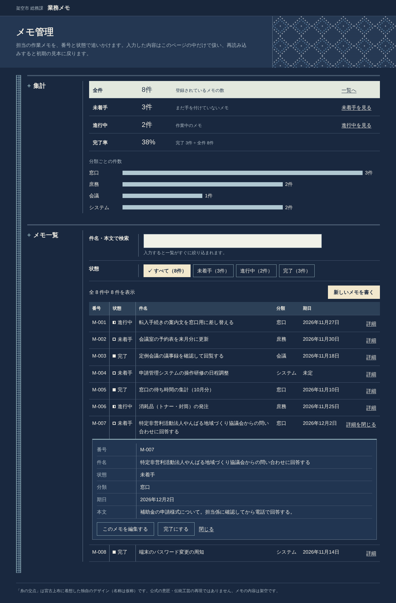

# 検証記録：okinawa-thread-ui Skill を別の画面に適用する（PoC）

[Skill の配布・導入方法（design-skills）](https://github.com/YanTKYS/design-skills#導入する)

「糸の交点」の Skill（[okinawa-thread-ui](https://github.com/YanTKYS/design-skills/tree/main/skills/okinawa-thread-ui)）を、比較サイトにない別の業務（職員の業務メモの管理）に当てはめて、Skill の資料だけで同じ系統の画面を組めるかを確かめた記録です。

> Skill の正本は [YanTKYS/design-skills](https://github.com/YanTKYS/design-skills/tree/main/skills/okinawa-thread-ui) に移りました。この見本は、Skill を design-lab で作った当時に作った**固定の見本**です。`assets/` は当時のコピーで、design-skills の最新版とは同期しません（design-lab での最後の版：[skills/okinawa-thread-ui](https://github.com/YanTKYS/design-lab/tree/0dfc2b7/skills/okinawa-thread-ui)）。

## 結論を読む前の注意

- **独立したエージェントのセッションでは試していません。** Skill を書いたのと同じ作業（同じ会話・同じ担当）の中で、続けて見本を作りました。作り手は比較サイトの実装を読んだ後なので、Skill の資料に書いていない知識が混ざっている可能性があります。
- Claude Code や Codex に Skill を導入して、Skill が自動で選ばれ・読まれるかは試していません。
- 判定は作り手自身によるもので、利用者による評価ではありません。

## 作り方

**参照した Skill のファイル**

- `SKILL.md`（手順と自己点検）
- `references/design-principles.md`（守る規則・調整してよい点・避ける実装）
- `references/patterns.md`（帯・格子帯・章と項目軸・台帳・行型の指標と横棒・操作とエラー・狭い幅）
- `assets/tokens.css`、`assets/thread-pattern.svg`（Skill の導入手順と同じく、[assets/](assets/) へそのままコピー。当時は中身が Skill と同じことをユニットテストで確認していた）

**依頼文として想定したもの**

```text
業務メモを管理する小さな画面（一覧・検索・状態の絞り込み・詳細・新規作成と編集・簡単な集計）を、
okinawa-thread-ui Skill を使って「糸の交点」で作ってください。
素の HTML / CSS / JavaScript で、外部の CDN・フォント・API は使わず、file:// で開けるようにしてください。
375px と 1280px で崩れないことを確認してください。
```

**作ったもの**：[index.html](index.html)、[app.css](app.css)、[app.js](app.js)。比較サイト（`site/`）のファイルは読み込まず、`main.js`・`data-action` の規約・共通モデルも使っていません。メモはページのメモリ上だけで扱い、保存・送信はしません。

Skill の「対象を先に確認する」手順は、新規作成のため「素の HTML、モジュールを使わない、保存しない」という前提の確認に置き換えました。

## 当てはめた内容

| Skill の規則 | この画面での形 |
| --- | --- |
| 識別子 → 状態 → 内容の読み順 | 番号（M-001）→ 状態（未着手・進行中・完了）→ 件名・分類・期日。番号と状態の右に縦軸 |
| 行の直下の詳細 | 「詳細」で行の直下に「項目名｜値」の軸の `dl`。編集・完了にする・閉じる |
| 章と項目軸 | 「集計」「メモ一覧」「新しいメモ（メモの編集）」の3章。章の上に二重罫、左に章見出しの欄 |
| 行型の指標と横棒 | 全件（明るい行）・未着手・進行中は一覧への絞り込みリンク付き。完了率はリンクなし。分類ごとの件数を横棒＋件数の文字で |
| 選択とフォーカス | 状態の絞り込みは生成りの塗り＋✓＋太字（`aria-pressed`）。フォーカスは黄色の外枠 |
| エラー | 件数と項目名のまとめにフォーカスを移し、リンクで該当欄へ。欄に太枠と「エラー：」の文、`aria-invalid` |
| 狭い幅 | 600px 未満で項目名を値の直上へ。表は行ごとにラベル付きの塊。格子帯を 8px に |
| 調整した点 | 推移のグラフは業務にないため作らず、分類ごとの件数だけを横棒にした。章見出しの欄を 180px、項目名の欄を 160px に縮めた |

## 確認した結果

Chromium（Playwright、ヘッドレス）で `file://` から開いて確認しました。

| 項目 | 結果 |
| --- | --- |
| 外部への通信 | なし（`file:` 以外の要求は 0 件） |
| ページ全体の横はみ出し | 375px・1280px とも 0px（操作の前後） |
| 検索 | 「窓口」で 8 件中 2 件。件数の文に「（絞り込み中）」 |
| IME | 変換中（「まどぐち」）は絞り込まず、確定後に 2 件へ絞り込む |
| 状態の絞り込み | 「完了」で 3 件。押したボタンにフォーカスが残る |
| 詳細の開閉 | `aria-expanded` が切り替わり、フォーカスは開閉ボタンに残る |
| 入力検証 | 空で保存 → エラーのまとめ（2件）にフォーカス → リンクで件名へ。`aria-describedby` にエラー文が入る |
| 保存 | 新しいメモ M-009 が一覧と集計に入り、「保存しました」を通知し、そのメモの詳細ボタンへフォーカス |
| 完了にする | 状態と集計（完了率）が更新される |
| 集計のリンク | 「未着手を見る」で一覧が未着手に絞り込まれ、一覧の章見出しへフォーカス |
| コントラスト（計算値） | 本文 12.4:1、補助文字 5.4〜7.6:1、入力欄 11.8:1、主操作 12.1:1、エラー文 8.5:1、フォーカス枠 10.3:1 |

画面写真（ヘッドレスの Chromium のため、期日の欄が英語の書式で表示されています）：

| | 1280px | 375px |
| --- | --- | --- |
| 一覧（M-007 の詳細を開いた状態） | [memo-1280-list.png](screenshots/memo-1280-list.png) | [memo-375-list.png](screenshots/memo-375-list.png)（詳細の直後まで） |
| 入力エラー | [memo-1280-form-error.png](screenshots/memo-1280-form-error.png) | [memo-375-form-error.png](screenshots/memo-375-form-error.png) |



## 判定

| 観点 | 判定 | 理由 |
| --- | --- | --- |
| ① 糸の交点だと分かるか | 分かる | 濃藍の地、見出し右端の十字の模様、左の格子帯、章の二重罫、生成りの主操作、行型の指標がそろい、比較サイトの「糸の交点」と同じ要素で構成されている（作り手の見立て） |
| ② 元の画面の丸写しでなく、新しい業務に合っているか | おおむね合っている | 申請の台帳の列や手順表示を持ち込まず、メモの「番号→状態→件名」に組み直した。推移グラフなど業務にない部品は作らなかった。ただし作り手が元の実装を知っているため、Skill の資料だけでここまで組めるかは未確認 |
| ③ 主要操作が動くか | 動く | 検索・絞り込み・詳細・新規・編集・検証・完了・集計のリンクを上の手順で確認 |
| ④ 狭い幅で読めるか | 読める | 375px で横はみ出しなし。項目名が値の直上、表はラベル付きの塊で、長い法人名も折り返す |

## 未確認のこと

- 独立したエージェント（別のセッション、Codex など）に Skill だけを渡したときの再現性。
- Claude Code・Codex での Skill の自動選択と読み込み。
- スクリーンリーダー、実機の IME、Chromium 以外のブラウザ、Windows の書体（BIZ UD 明朝・游明朝）での見え方。
- 長時間の入力で、暗い地と明るい入力欄の繰り返しがまぶしくないか。
